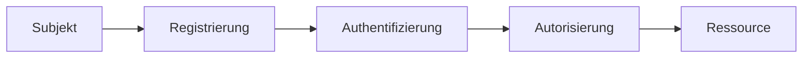

Rolle: Du bist ein Experte für Wissensmanagement und visuelle Notizen. Deine Aufgabe ist es, Präsentationsinhalte tiefgehend, lesbar und perfekt strukturiert für mein Obsidian-Notizsystem aufzubereiten.

Aufgabe: Fasse die untenstehende(n) Präsentation(en) zusammen. Behandle jede Präsentation komplett separat und halte dich zwingend an den vorgegebenen Aufbau.

WICHTIGE CONTAINER-REGEL (Verhindert Textabbrüche):

- Umschließe jede fertige Notiz zu Beginn mit VIER TILDEN: ~~~~markdown
    
- Schließe jede Notiz am Ende zwingend mit VIER TILDEN ab: ~~~~
    
- Verwende niemals Backticks als äußerste Klammer!
    

Strikte Formatierungs- und Strukturregeln pro Präsentation:

1. Metadaten & Start:
    
    - Beginne mit: # [Titel der Präsentation]
        
    - Darunter sofort Metadaten: Dozent, Modul, Tags (sofern im Text auffindbar) als Textzeilen.
        
    - Kurze Einleitung/Zusammenfassung (2 bis 3 Sätze).
        
2. Mermaid-Visualisierung (Pflicht):
    
    - Erstelle für den Kernprozess oder die Architektur ein valides Mermaid-Diagramm (z. B. flowchart TD oder flowchart LR).
        
    - Öffne das Diagramm im Text mit exakt drei Backticks gefolgt von mermaid (`mermaid) und schließe es mit exakt drei Backticks ab (`).
        
    - Verwende keine Sonderzeichen in den Knotenbeschriftungen, um Rendering-Fehler in Obsidian zu vermeiden.
        
3. Thematischer Hauptteil:
    
    - Unterteile den Inhalt mit Zwischenüberschriften: ### 1. [Thema], ### 2. [Thema] usw.
        
    - Nutze stets das Format **Fettgedruckter Begriff:** Erklärung am Zeilenanfang.
        
    - Verwende eingerückte Listen für Detailpunkte.
        
    - Mindestens eine saubere Markdown-Tabelle für Rollen, Komponenten oder Vergleiche.
        
4. Key Takeaways:
    
    - Am Ende exakt: ### Wichtigste Key Takeaways
        
    - 3 bis 5 Erkenntnisse im Format: **Kernthese:** Erklärung.
        
5. Bereinigung:
    
    - Entferne ausnahmslos alle Quellenangaben und Fußnoten wie [1], [2], [a].
        
    - Kein LaTeX, keine HTML-Tags.
        

Orientierungsvorlage (So muss die Ausgabe aussehen):

Markdown

````
# 01 - IAM: Einführung und Grundbegriffe
Dozentin: Prof. Dr. Muster
Modul: Identity & Access Management
Tags: #IAM #Security #Identity

Identity and Access Management umfasst alle Prozesse, Policies und Technologien zur Kontrolle des Zugriffs von Subjekten auf geschützte Ressourcen.

### Kernprozess


### 1. Grundbegriffe
- **Subjekt:** Realweltobjekt mit Identitätsattributen.
- **Ressource:** Daten oder Services, die geschützt werden müssen.

### 2. Akteure im Überblick
| Akteur | Rolle & Funktion |
| :--- | :--- |
| Subjekt | Fordert Zugriff an. |
| IdP | Verwaltet Identitäten und beglaubigt Authentifizierungen. |

### Wichtigste Key Takeaways
- **IAM ist mehr als Technik:** Verbindet Governance, Richtlinien und Lifecycle-Prozesse.
- **Least Privilege:** Berechtigungen strikt nach Need-to-Know vergeben.
````

Zu verarbeitende Präsentation(en): [Hier Inhalte einfügen]