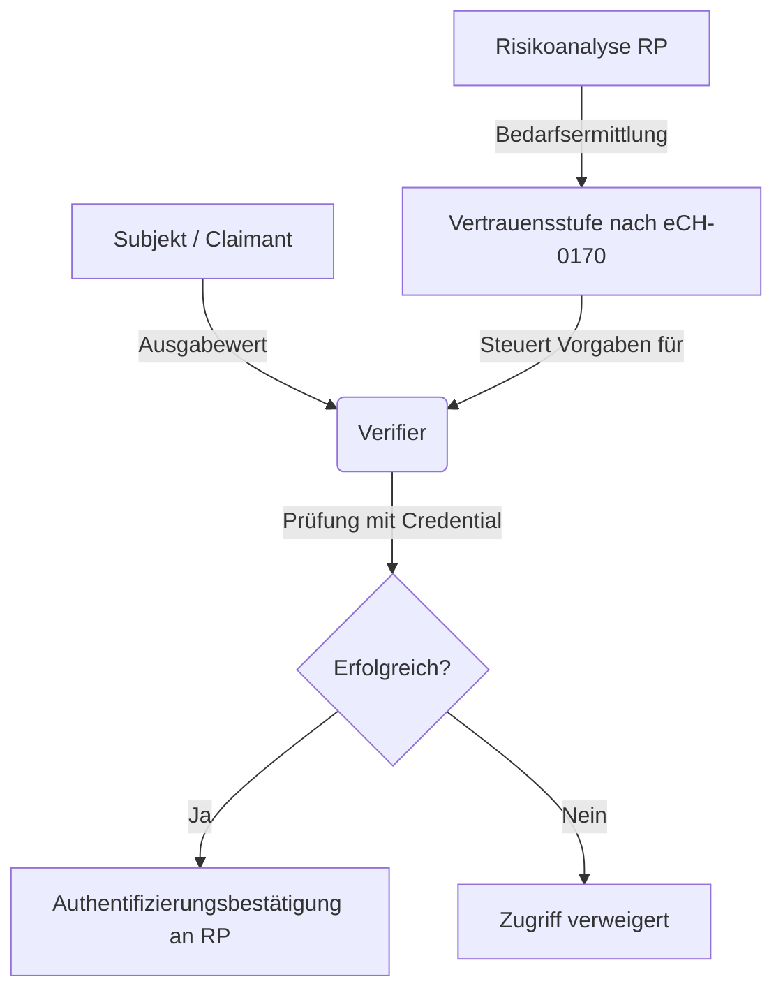

# IAM: Authentifizierungsmittel, Faktoren & Qualitätsmodelle
Dozent: Prof. Dr. Annett Laube
Modul: Identity & Access Management (HS 2026)
Tags: #IAM #Authentifizierung #Credentials #Qualitätsmodelle #eCH0170 #Obsidian

Die vorliegenden Vorlesungsunterlagen behandeln die theoretischen und praktischen Grundlagen von Authentifizierungsmitteln, deren Faktoren sowie die Einstufung und Bewertung von IAM-Architekturen anhand von Qualitäts- und Vertrauensmodellen (insbesondere eCH-0170 v2 und NIST SP 800-63).

### Kernprozess

### 1. Authentifizierung & Authentifizierungsmittel
- **Definition Authentifizierung:** Wiederkehrender Prozess zur Überprüfung der Zugehörigkeit einer (Teil-)Identität zu einem Subjekt bzw. Nachweis, dass das Subjekt die Kontrolle über die Geheimnisse besitzt.
- **Authentifizierungsmittel:** Informationen oder Prozesse (Token, Passwörter, Hardware), die zur Authentifizierung dienen. Sie berechnen über eine Authentifizierungsfunktion aus einem geheimen Wert sowie optionalen Aktivierungs- und Eingabewerten einen Ausgabewert.
- **Credential (Identitätsnachweis):** Datenmenge (keine Hardware), die eine Identität an ein Authentifizierungsmittel bindet (z. B. Passwort-Hash, Zertifikat, Biometrie-Abbild).

### 2. Kategorien & Faktoren
- **Kategorien (Faktoren):**
  - **Kenntnis (*something you know*):** Passwörter, PINs.
  - **Besitz (*something you have*):** Hardware-/Soft-Token, Smartcards, kryptografische Schlüssel.
  - **Inhärenz (*something you are*):** Biometrische Merkmale wie Fingerabdruck, Gesicht, Iris, Venenmuster.
  - **Verhalten (*something you do*):** Dynamische Unterschrift, Tippverhalten, Gangart.
- **MFA-Umsetzung:**
  - **Multiple Single-Factor:** Mehrere separate SF-Authentifikatoren werden präsentiert (jeder mit eigenem Credential am IdP registriert).
  - **Multi-Factor Authenticator:** Ein Authentifikator mit nur einem am IdP registrierten Credential; das interne Geheimnis wird durch einen zweiten Faktor lokal freigeschaltet (z. B. Smartcard + PIN).

### 3. Qualitätsmodell nach eCH-0170 v2
Das Schweizer Standardmodell leitet aus einer Risikoanalyse vier Vertrauensstufen (1 = minimal bis 4 = hoch) über vier Teilmodelle ab, wobei stets das schwächste Glied die Gesamteinstufung bestimmt:

| Teilmodell                  | Fokus & Kriterien                                                                                    | Ausprägungen Stufe 1 bis 4                                                                                                                                                                                     |
| :-------------------------- | :--------------------------------------------------------------------------------------------------- | :------------------------------------------------------------------------------------------------------------------------------------------------------------------------------------------------------------- |
| **VSA (Authentifizierung)** | Stärke des Mittels, Zertifizierung, Re-Authentifizierungszeitraum                                    | Stufe 1: SFA / ReAuth 30 Tage Stufe 2: MFA / ReAuth 18 h Stufe 3: HW-MFA / ReAuth 12 h Stufe 4: Zertifizierte HW-MFA (FIPS 140-2 L3 / CC EAL4+) / ReAuth 30 min                                       |
| **VSR (Registrierung)**     | Identifikation (Anwesenheit, Beweismittel, Validierung, Nichtabstreitbarkeit), Übergabe & Erneuerung | Stufe 1: Selbstdeklaration, einfache Post Stufe 2: Geprüfte Beweismittel, sichere Zustellung Stufe 3: Starke Validierung, Ausweiskopie Stufe 4: Biometrie-Abgleich, persönliche/eigenhändige Übergabe |
| **VSS (Steuerung)**         | Aufsicht, Haftung und Prozessreife (Maturität)                                                       | Stufe 1: Keine Aufsicht / keine Haftung Stufe 4: Audit akkreditierte Stelle, gesetzliche Haftung & Konventionalstrafe, optimierte Prozesse                                                                  |
| **VSF (Föderierung)**       | Übertragungskanal (Front/Back), Vertraulichkeit, Signatur, Bindung                                   | Stufe 1–2: Bearer-Token, Signatur, optionale Verschlüsselung Stufe 3: Holder-of-Key (HoK), gegenseitiges TLS, Schutz vor XSS/MitM                                                                           |

### Wichtigste Key Takeaways
- **Credential vs. Authentifikator:** Ein Credential ist rein datenbasiert (z. B. Hash, Public Key) und dient dem Verifier zum Abgleich des vom Authentifikator erzeugten Ausgabewerts.
- **Minimalprinzip bei Vertrauensstufen:** Die niedrigste erreichte Stufe innerhalb der Kriterien und Teilmodelle bestimmt das Gesamtniveau des IAM-Systems.
- **Holder-of-Key schützt Föderationen:** Auf Stufe VSF 3 verhindert die kryptografische Bindung (z. B. SAML HoK Web SSO via Client-Zertifikat) das Ausnutzen abgefangener Assertions.
- **Mensch vs. Maschine:** Während bei Personen Usability und interaktive Protokolle (OIDC, SAML) im Vordergrund stehen, nutzen Maschinen automatisierte Zertifikate/Tokens über mTLS.