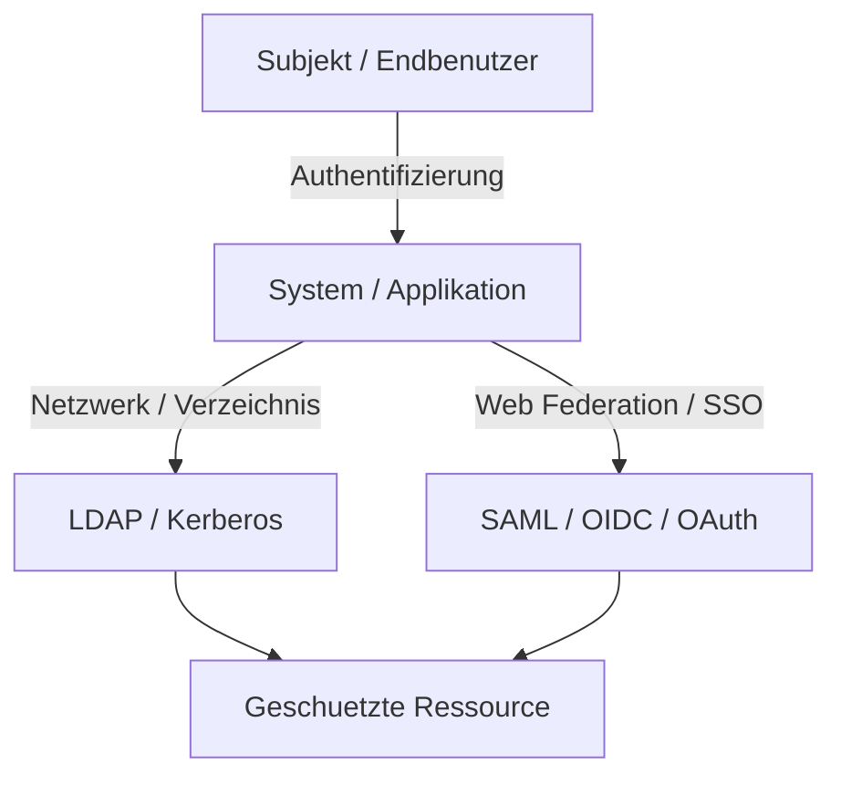
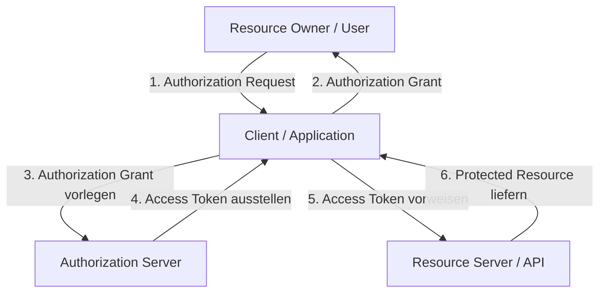
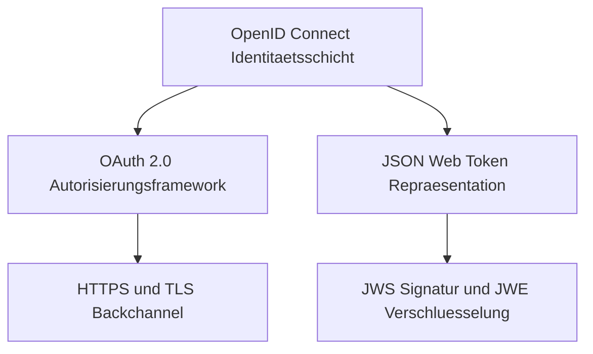
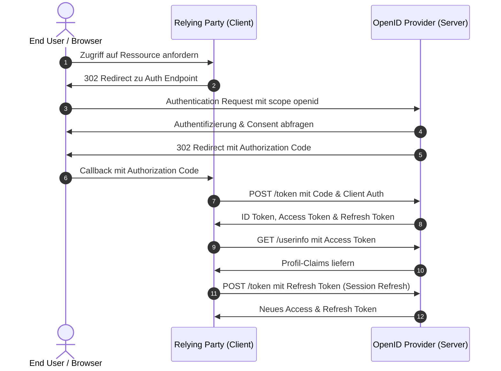

# Authentifizierungsprotokolle
Dozentin: Prof. Dr. Annett Laube
Modul: Identity & Access Management (HSLU)
Tags: #IAM #Authentifizierung #Protokolle #Security #Kerberos #LDAP #SAML #OAuth #OIDC

Authentifizierungsprotokolle bilden das kryptographische Fundament für die sichere Übertragung von Identitätsdaten zwischen mindestens zwei Parteien in modernen Computernetzwerken und Applikationen. Sie regeln den Nachweis von Identitäten bei Systemanmeldungen, Netzwerkzugriffen sowie einzelnen geschäftskritischen Transaktionen. Neben klassischen Netzwerk- und Verzeichnisprotokollen haben sich für moderne Webanwendungen vor allem Standards wie SAML, OAuth 2.0 und OpenID Connect etabliert.

### Kernarchitektur von Authentifizierungsprotokollen

### 1. Definition und Einsatzzwecke
- **Authentifizierungsprotokoll:** Ein kryptographisches Kommunikationsprotokoll zur verlässlichen Übertragung von Authentifizierungsdaten zwischen zwei oder mehr Entitäten.
- **Anmeldung am System:** Verifikation eines Subjekts beim erstmaligen Einloggen in ein Betriebssystem oder eine Anwendung.
- **Netzwerkauthentifizierung:** Absicherung des Zugriffs von Rechnern und Nutzern auf interne Netzwerkressourcen und Domänendienste.
- **Transaktionsauthentifizierung:** Gezielte Bestätigung einzelner Aktionen oder Finanztransaktionen innerhalb einer bereits bestehenden Session.

### 2. Protokollprinzipien und Qualitätsmerkmale
- **Beteiligte Parteien:** Es müssen mindestens zwei Parteien involviert sein, die die Protokollregeln vorab vollständig kennen und strikt befolgen.
- **Eindeutigkeit und Vollständigkeit:** Jeder Einzelschritt ist exakt spezifiziert, und das Protokoll deckt alle möglichen Szenarien inklusive Fehlerfälle ab.
- **Sicherheitsanforderungen:**
    - **Freshness & Replay-Schutz:** Einsatz von Zeitstempeln und kryptographischen Einmalwerten (Nonces) gegen Wiedereinspielungsangriffe.
    - **Vertraulichkeit & Integrität:** Durchgängige Absicherung über TLS-Tunnel sowie digitale Signaturen oder Verschlüsselung.
- **Betriebliche Anforderungen:** Hohe Skalierbarkeit, Benutzerfreundlichkeit, herstellerübergreifende Interoperabilität und lückenlose Auditierbarkeit.

### 3. Protokollfamilien im Vergleich
| Protokoll | Kategorie | Primärer Einsatzzweck | Kerntechnologie |
| :--- | :--- | :--- | :--- |
| LDAP | Verzeichnisdienst | Benutzerverwaltung & zentrale Abfragen in Enterprise-Netzen | Client-Server-Verzeichnisprotokoll |
| Kerberos | Netzwerkauthentifizierung | Domänenauthentifizierung (z. B. Active Directory), Ticket-basiertes SSO | Symmetrische Kryptographie & KDC |
| SAML | Web-Authentifizierung / SSO | Webbasierte Föderation und organisationsübergreifendes Single Sign-On | XML & XML-Signaturen |
| OAuth 2.0 | Delegierte Autorisierung | Gekapselte Rechtedelegation an Drittanbieter (APIs) | HTTPS, JSON, Access Tokens |
| OpenID Connect | Web-Authentifizierung | Identitätsnachweis und Profilabruf auf Basis von OAuth 2.0 | HTTPS, JSON Web Tokens (JWT) |

### Wichtigste Key Takeaways
- **Fundament sicherer Kommunikation:** Authentifizierungsprotokolle garantieren die sichere Identitätsfeststellung über unsichere Netzwerke hinweg.
- **Strikte Spezifikationsdisziplin:** Ein fehlerfreies Protokoll erfordert vollständige Zustandsdefinitionen und strikte Einhaltung durch alle beteiligten Parteien.
- **Vielschichtige Sicherheitskriterien:** Replay-Schutz durch Nonces, Freshness-Garantien und TLS-Transportverschlüsselung sind unverzichtbar.
- **Differenzierte Einsatzgebiete:** Während Kerberos und LDAP lokale Netzwerke dominieren, basieren moderne Webservices auf SAML und OIDC.

# Authentifizierungsprotokolle - OAuth 2.0
Dozentin: Prof. Dr. Annett Laube
Modul: Identity & Access Management (HSLU)
Tags: #IAM #OAuth2 #Security #API #Authorization #PKCE #Tokens

OAuth 2.0 ist ein etablierter offener Standard zur delegierten Autorisierung, der Anwendungen einen eingeschränkten Zugriff auf geschützte Webressourcen ermöglicht, ohne Benutzerpasswörter preiszugeben. Das Framework trennt Authentifizierung strikt von Autorisierung und operiert über JSON-basierte Nachrichten via HTTPS. Mit der Weiterentwicklung zu OAuth 2.1 werden veraltete Mechanismen bereinigt und Sicherheitserweiterungen wie PKCE standardmäßig zur Pflicht erhoben.

### Abstrakter OAuth 2.0 Protokollfluss

### 1. Grundlagen und Rollenkonzept
- **OAuth 2.0 Wesen:** Kein Authentifizierungsprotokoll, sondern ein reines Framework zur Delegierung von Berechtigungen auf Basis von RFC 6749 und RFC 6750.
- **Resource Owner:** Das Subjekt (der Benutzer), welches die Eigentumsrechte an den geschützten Ressourcen hält.
- **Client:** Die Softwareanwendung, die im Namen des Resource Owners Zugriff auf definierte Datenbereiche anfordert.
    - **Public Client:** Anwendungen ohne sichere Speicherumgebung für Geheimnisse (z. B. Single-Page-Apps im Browser, Mobile Apps, IoT).
    - **Confidential Client:** Backend-Systeme (z. B. Webserver), die eigene Client Secrets vertraulich vor Dritten isolieren können.
- **Authorization Server:** Authentifiziert den Benutzer, holt dessen Einwilligung ein und stellt zeitlich limitierte Tokens aus.
- **Resource Server:** Hostet die geschützten Ressourcen und validiert eingehende Access Tokens bei API-Anfragen.

### 2. Token-Arten und Registrierung
- **Client-Registrierung:** Jeder Client muss vorab beim Autorisierungsserver registriert sein.
    - **Client Identifier:** Öffentliche Kennung der Applikation.
    - **Client Secret:** Streng vertraulicher Schlüssel zur Authentifizierung von Confidential Clients.
    - **Redirect URI:** Fest hinterlegte Rückrufadresse für den Empfang von Codes oder Tokens.
- **Access Token:** Zeitlich kurzlebiger Schlüssel (Minuten bis Stunden), der den Zugriff auf APIs innerhalb eines Scopes erlaubt.
- **Refresh Token:** Langlebiger Token, der den Bezug neuer Access Tokens ermöglicht, ohne dass der Benutzer erneut interagieren muss.

### 3. Autorisierungsflüsse (Grants)
- **Authorization Code Flow:** Zweistufiger Standardfluss für serverseitige Webanwendungen über Front-Channel (User-Agent) und TLS-gesicherten Back-Channel.
- **Authorization Code Flow mit PKCE:** Proof Key for Code Exchange schützt vor Code-Injection und Interception mittels dynamischer Prüfschlüssel (`code_challenge` und `code_verifier`).
- **Client Credentials Flow:** Rein serverseitige Machine-to-Machine (M2M) Autorisierung ohne Beteiligung eines Endbenutzers.
- **Legacy Flows:** Veraltete Ansätze wie Implicit Grant und Resource Owner Password Credentials werden in sicheren Implementierungen abgelöst.

### 4. Rollen- und Flussübersicht
| Flow / Rolle | Hauptakteure | Transportkanal | Primärer Use Case |
| :--- | :--- | :--- | :--- |
| Authorization Code + PKCE | User, Browser, Client, AS, RS | Front- und Back-Channel | Native Apps, SPAs und Web-Backends |
| Client Credentials | Client (Daemon/Service), AS, RS | Reiner Back-Channel | Backend-Synchronisation, Daemons, M2M |
| Public Client | Client ohne Secret, AS | Front-Channel / TLS-Back-Channel | Mobile-Apps, Single-Page-Browser-Apps |
| Confidential Client | Client mit Secret, AS | Gesicherter Back-Channel | Klassische Webserver mit sicherem Backend |

### Wichtigste Key Takeaways
- **Autorisierung statt Authentifizierung:** OAuth 2.0 liefert Berechtigungen für APIs, liefert dem Client jedoch originär keine Identitätsdaten des Subjekts.
- **Keine Passwortweitergabe:** Drittanwendungen erhalten Zugriff ausschließlich über zeitlich limitierte Scopes via Tokens.
- **PKCE ist unverzichtbar:** Die Kopplung von Code Verifier und Code Challenge schützt moderne Clients wirksam gegen Abfangangriffe.
- **Konsolidierung durch OAuth 2.1:** Unsichere Altlasten wie der Implicit Grant entfallen zugunsten strikter PKCE- und Redirect-URI-Prüfungen.

# Authentifizierungsprotokolle - OIDC
Dozentin: Prof. Dr. Annett Laube
Modul: Identity & Access Management (HSLU)
Tags: #IAM #OIDC #OpenIDConnect #JWT #SSO #Authentifizierung #Security

OpenID Connect 1.0 (OIDC) erweitert das Autorisierungs-Framework OAuth 2.0 um eine standardisierte Identitäts- und Authentifizierungsschicht. Es schließt die funktionale Lücke von OAuth, indem es Clients ermöglicht, Benutzer eindeutig zu authentifizieren, Profilinformationen standardisiert abzufragen und Anmeldesitzungen zu etablieren. Als Datenformat nutzt OIDC signierte und optional verschlüsselte JSON Web Tokens (JWT).

### OIDC-Schichtenmodell und Architektur

### 1. Grundlagen und Protocol Suite
- **OIDC Konzept:** Standardisierte Erweiterung von OAuth 2.0, aktiviert durch den Scope-Parameter `scope=openid`.
- **Relying Party (RP):** Ein OAuth 2.0 Client, der OIDC nutzt, um Benutzeridentitäten zu prüfen.
- **OpenID Provider (OP):** Ein OAuth 2.0 Autorisierungsserver, der Identitäten beglaubigt und ID Tokens ausstellt.
- **Bestandteile der Suite:** Umfasst den Core-Standard, Discovery (dynamisches Auffinden von OP-Endpunkten), Dynamic Registration sowie standardisiertes Session Management.

### 2. Endpunkte und Token-Struktur
- **Authorization Endpoint:** Endpunkt zur Interaktion mit dem Endnutzer (Login, Consent-Einholung).
- **Token Endpoint:** Endpunkt zum TLS-gesicherten Back-Channel-Tausch des Codes gegen Tokens.
- **UserInfo Endpoint:** Mit einem Access Token geschützte API zur standardisierten Abfrage von Nutzerattributen (Claims).
- **Logout Endpoint:** Beendet die Nutzersitzung am OP und invalidiert Session-Zustände.
- **ID Token:** Signiertes JSON Web Token (JWS) mit standardisierten Claims:
    - **Header:** Enthält kryptographische Metadaten wie den Signaturalgorithmus (`alg`).
    - **Payload:** Beinhaltet Identitätsaussagen wie `iss` (Issuer), `sub` (Subject-ID), `aud` (Audience/Client-ID), `iat` (Issued At) und `exp` (Ablaufzeit).
    - **Signatur:** Verhindert Manipulationen und garantiert die Authentizität des Ausstellers.

### 3. Protokollabläufe und Sicherheitsmechanismen
- **Authorization Code Flow:** Standard für Web- und Native-Apps mit maximaler Sicherheit durch Back-Channel-Tokenbezug.
- **Implicit Flow & Hybrid Flow:** Veraltete bzw. kombinierte Ansätze; der reine Implicit Flow wird aufgrund von Sicherheitsrisiken nicht mehr empfohlen.
- **Replay-Schutz:** Der Parameter `nonce` verknüpft die Client-Session mit dem ID Token und wehrt Angriffe durch Token-Wiedereinspielung ab.

### 4. Komponenten und Flow-Vergleich
| Komponente / Flow | Rolle & Funktion | Sicherheitsmerkmale |
| :--- | :--- | :--- |
| Relying Party (RP) | Fordert Benutzerauthentifizierung und Claims an | Validiert ID-Token-Signatur und Nonce |
| OpenID Provider (OP) | Authentifiziert Endbenutzer und signiert ID Tokens | Stellt Claims via Token oder UserInfo-API bereit |
| Authorization Code Flow | Tausch des Codes am Token Endpoint gegen ID & Access Token | TLS-Backchannel-Kommunikation, Client-Authentifizierung |
| UserInfo Endpoint | Liefert Detailprofile (Name, E-Mail, Profilbild) | Durch Bearer Access Token geschützte REST-API |

### Wichtigste Key Takeaways
- **Identität auf Basis von Autorisierung:** OIDC nutzt die bewährte OAuth 2.0-Infrastruktur und ergänzt diese um standardisierte Nutzerauthentifizierung.
- **Das ID Token als Ausweis:** JWTs bieten manipulationssichere, signierte Aussagen über die Identität des Subjekts und den Login-Zeitpunkt.
- **Schutz vor Pseudo-Authentifizierung:** Im Gegensatz zum anonymen Access Token verknüpft das ID Token den Login kryptographisch mit der anfragenden Relying Party.
- **Zentralisierung mit Restrisiko:** OIDC bietet hohen SSO-Komfort und entlastet Applikationen, erfordert jedoch robuste Phishing-Abwehr auf Provider-Ebene.

# OIDC-Flows: Handout für Rollenspiel
Dozentin: Prof. Dr. Annett Laube
Modul: Identity & Access Management (HSLU)
Tags: #IAM #OIDC #Rollenspiel #Flows #Logout #SessionRefresh #AuthorizationCode

Dieses Handout dient als praktische Anleitung zur Rekonstruktion zentraler OpenID Connect Protokollflüsse in einem Rollenspiel. Es detailliert die Interaktionen zwischen Endbenutzer, User Agent, Relying Party und OpenID Provider über Front- und Back-Channel. Behandelt werden der vollständige Authorization Code Flow, das Session-Refresh über Refresh Tokens sowie der geordnete Logout.

### Vollständiger Authorization Code & Refresh Flow

### 1. Akteure und Token-Typen im Rollenspiel
- **End User & User Agent:** Der Endbenutzer interagiert über den Webbrowser zur Eingabe von Zugangsdaten und Erteilung von Berechtigungen.
- **Relying Party (RP):** Die Client-Applikation, welche den Benutzer über den IdP authentifiziert und API-Zugriffe verwaltet.
- **OpenID Provider (OP):** Der Autorisierungsserver, welcher Anmelde-, Token- und UserInfo-Endpunkte bereitstellt.
- **Verwendete Token:**
    - **Authorization Code:** Kurzlebiger Einmalcode (ca. 10 Minuten gültig), an Client-ID und Redirect-URI gebunden.
    - **Access Token:** Bearer-Token zur Autorisierung von Anfragen am UserInfo-Endpunkt oder an APIs.
    - **ID Token:** Signiertes Datenpaket (JWS) mit Nachweis der Authentifizierung und Subjekt-ID (`sub`).
    - **Refresh Token:** Langlebiges Secret zur nahtlosen Erneuerung abgelaufener Access Tokens.

### 2. Detaillierter Ablauf: Authorization Code Flow
- **Schritt 0 bis 1b (Initialisierung & Redirect):**
    - Nutzer greift ohne Sitzung auf den Client zu.
    - Client antwortet mit HTTP `302 Found` und leitet den Browser zum `/authorize`-Endpunkt mit Parametern wie `response_type=code`, `scope`, `client_id`, `state` und `redirect_uri` weiter.
- **Schritt 2a bis 3b (Login, Consent & Code-Rückgabe):**
    - Server validiert den Request, authentifiziert den Benutzer und holt die Autorisierungszustimmung ein.
    - Server sendet einen Redirect via Browser mit dem Autorisierungscode zurück an die `redirect_uri`.
- **Schritt 4a bis 5 (Token-Tausch per Back-Channel):**
    - Client sendet einen TLS-gesicherten HTTP `POST` an den `/token`-Endpunkt und authentifiziert sich (z. B. via Basic Auth).
    - Server validiert den Code und antwortet mit `id_token`, `access_token` und optional `refresh_token`.
    - Client verifiziert das ID Token und ermittelt die `sub`-ID.
- **Schritt 6a bis 6b (UserInfo-Abfrage):**
    - Optionaler Abruf von Profildaten (z. B. `name`, `email`) am `/userinfo`-Endpunkt unter Vorlage des Access Tokens.

### 3. Session-Refresh und Logout
- **Session-Refresh:** Client verlängert die Sitzung ohne Nutzerinteraktion via HTTP `POST` mit `grant_type=refresh_token` am Token-Endpunkt und erhält ein neues Access- und Refresh-Token-Paar.
- **Logout-Ablauf:**
    - **Lokale Bereinigung:** Client löscht Browser-Cookies, lokalen Speicher und beendet die Sitzung.
    - **OP-Terminierung:** Client leitet via Browser an den Logout-Endpunkt des Servers weiter, empfohlenerweise mit `id_token_hint` und `post_logout_redirect_uri`.
    - **Token-Invalidierung:** Server beendet die Nutzersitzung, widerruft Tokens und leitet zur finalen Bestätigungsseite zurück.

### 4. Endpunkte des OpenID Providers
| Endpunkt | Protokoll-Kanal | Funktion | Typische Eingabe / Ausgabe |
| :--- | :--- | :--- | :--- |
| Authorization Endpoint | Front-Channel (Browser) | Nutzer-Authentifizierung & Consent | Parameter im GET / 302 Redirect mit Code |
| Token Endpoint | Back-Channel (TLS Direct) | Ausgabe und Tausch von Tokens | POST mit Code/Refresh-Token / JSON mit Tokens |
| UserInfo Endpoint | Back-Channel (TLS Direct) | Übermittlung von Profildaten | GET mit Bearer Access Token / JSON mit Claims |
| Logout Endpoint | Front- / Back-Channel | Vollständige Sitzungsbeendigung | GET mit id_token_hint / Redirect nach Logout |

### Wichtigste Key Takeaways
- **Zweikanal-Architektur schützt Secrets:** Die strikte Trennung zwischen Front-Channel (Browser-Weiterleitung) und Back-Channel (Server-to-Server) verhindert Token-Diebstahl.
- **Kryptographische Sitzungsbindung:** Der Authorization Code bindet Client-ID, Redirect-URI und Session eindeutig aneinander.
- **Unterbrechungsfreier Betrieb:** Refresh Tokens sichern persistente Workflows, ohne dass permanente Benutzer-Logins erforderlich sind.
- **Synchronisierter Session-Lifecycle:** Ein vollständiger Logout erfordert immer die Bereinigung lokaler RP-Zustände sowie die Token-Revokation am IdP.