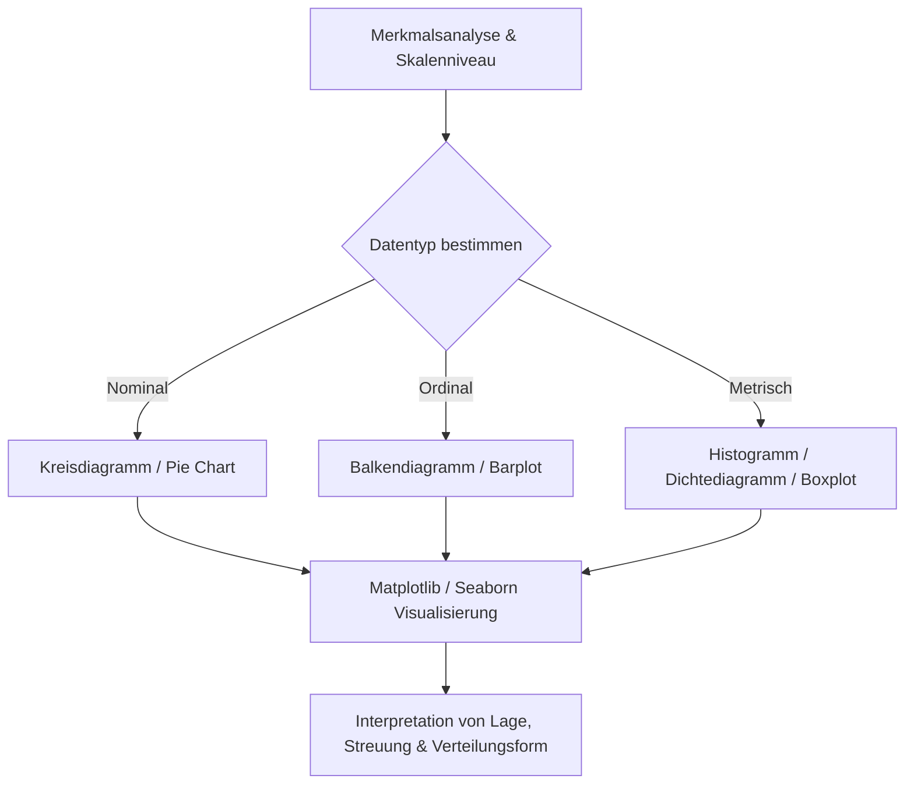

# Datenvisualisierung mit Python
Dozent: Nicht angegeben
Modul: Datenanalyse / Angewandte Statistik mit Python
Tags: #Python #Datenvisualisierung #Matplotlib #Seaborn #Statistik #Pandas

Diese Lerneinheit vermittelt praxisnah die Grundlagen der grafischen Datenanalyse zur Darstellung von Verteilungen nominaler, ordinaler und metrischer Merkmale. Neben theoretischen Grundlagen zu Lage- und Streuungsmaßen werden die Standard-Bibliotheken Matplotlib und Seaborn anhand konkreter Codebeispiele eingeführt. Die Studierenden lernen Diagrammtypen von Kreisdiagrammen über Box-Plots bis hin zu komplexen Regenwolken-Plots zielgerichtet einzusetzen und zu interpretieren.

### Kernprozess

### 1. Skalenniveaus und passende Diagrammtypen
- **Nominale Merkmale:** Qualitative Ausprägungen ohne natürliche Rangfolge (z. B. Geschlecht). Werden bevorzugt als Kreisdiagramm dargestellt, wobei relative Häufigkeiten proportional als Kreissektoren abgebildet werden.
- **Ordinale Merkmale:** Kategorien mit logischer Rangordnung, jedoch ohne quantifizierbare Abstände (z. B. Prädikate wie genügend bis ausgezeichnet). Die Visualisierung erfolgt idealerweise als Balkendiagramm von links nach rechts.
- **Metrische Merkmale:** Quantitative Zahlenwerte mit messbaren Abständen (z. B. Alter, Gewicht). Die Abbildung erfolgt über Histogramme, Dichtediagramme oder Box-Plots zur Identifikation von Lagemassen und Streuungen.

### 2. Übersicht der Visualisierungsbibliotheken
| Merkmal / Aspekt | Matplotlib | Seaborn |
| :--- | :--- | :--- |
| **Rolle & Charakter** | Fundamentale Standardbibliothek und flexibler Werkzeugkasten | Statistische High-Level-Erweiterung auf Basis von Matplotlib |
| **Syntax & Aufwand** | Detaillierte Konfigurationen für jede Achse und Figur nötig | Einfache Syntax und ansprechendes Design out of the box |
| **Pandas-Integration** | Manuelle Aufbereitung von Datenreihen oft erforderlich | Direkte Unterstützung von DataFrames inklusive automatischer Beschriftung |
| **Typische Plot-Typen** | `pie()`, `plot()`, Basisfunktionen | `countplot()`, `histplot()`, `boxplot()`, `swarmplot()` |

### 3. Statistische Diagrammtypen und ihre Eigenschaften
- **Kreisdiagramm (Pie Chart):** Bildet Anteile an einer Gesamtheit ab. Über Format-Strings wie `%1.0f%%` lassen sich Nachkommastellen und Prozentzeichen steuern; der Dispersionsindex misst hierbei die Streuung von null (keine Streuung) bis eins (maximale Streuung).
- **Balkendiagramm:** Stellt absolute oder relative Häufigkeiten dar, wobei die Höhe der Balken die Häufigkeit wiedergibt und die Sortierung der ordinalen Rangfolge folgt.
- **Histogramm & Dichtediagramm:** Gruppieren metrische Daten in Klassen (Bins). Beim Histogramm entspricht die Rechteckhöhe der Häufigkeit; beim Dichtediagramm beträgt die Gesamtrechteckfläche stets eins bzw. 100 %.
- **Verteilungsformen:** Beschreiben die Symmetrie metrischer Daten als symmetrisch, linksschief (extreme Werte links) oder rechtsschief (extreme Werte rechts).
- **Box-Plot:** Visualisiert Median, Quartile und den Quartilsabstand $Q$. Whisker begrenzen den normalen Wertebereich, während Punkte jenseits von $1.5 \cdot Q$ als Ausreißer deklariert werden.
- **Regenwolken-Plot:** Kombination aus Box-Plot und Einzelpunkten (z. B. via `swarmplot` oder `stripplot`), um Rohdaten, Streuung und Subgruppen gleichzeitig darzustellen.

### Wichtigste Key Takeaways
- **Skalenniveau diktiert Diagrammtyp:** Die Art des Merkmals entscheidet zwingend über die adäquate Visualisierungsform.
- **Spezialisierung der Tools:** Matplotlib fungiert als universelle Basis, während Seaborn komplexe statistische Zusammenhänge mit minimalem Code visualisiert.
- **Flächenlogik im Dichtediagramm:** Die Gesamtfläche aller Segmente summiert sich mathematisch exakt auf 100 %.
- **Box-Plot-Effizienz:** Ein kompakter Box-Plot bündelt Lage, Streuung, Schiefe und Extremwerte übersichtlich in einer einzigen Grafik.