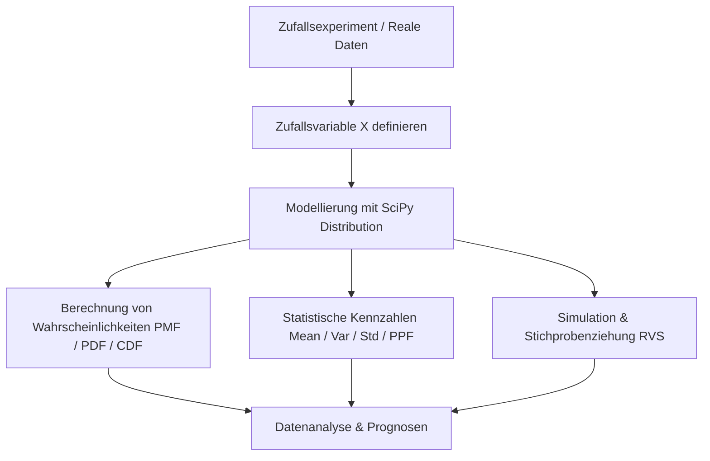

# Modelle für zufällige Ereignisse mit Python
Dozent: Nicht angegeben
Modul: Statistik / Datenanalyse mit Python
Tags: #Statistik #Python #SciPy #Wahrscheinlichkeitsrechnung #Zufallsvariablen

Dieser Vortrag behandelt mathematische Modelle für Zufallsprozesse und deren praktische Umsetzung mit Python und der Bibliothek SciPy. Anhand von Beispielen wie dem fairen Würfel sowie theoretischen Verteilungen (diskret uniform, Bernoulli, Binomial, Geometrisch, Poisson, Hypergeometrisch und stetig uniform) werden Konzepte wie Erwartungswert, Varianz, Standardabweichung und Quantile vermittelt.

### Kernprozess

### 1. Grundlagen von Zufallsvariablen und Verteilungen
- **Zufallsvariable:** Mathematisches Modell, das den Ergebnissen eines Zufallsexperiments reelle Zahlenwerte zuordnet.
- **Wahrscheinlichkeitsverteilung:** Theoretische Zuordnung von Wahrscheinlichkeiten zu den Werten einer Zufallsvariablen, im Gegensatz zur empirischen Häufigkeitsverteilung aus Beobachtungen.
- **Kumulative Verteilungsfunktion:** Gibt die Wahrscheinlichkeit an, dass die Zufallsvariable einen Wert kleiner oder gleich einer Schranke annimmt.
- **Erwartungswert:** Theoretisches Lagemaß einer Verteilung, das dem arithmetischen Mittel der empirischen Daten entspricht.
- **Varianz und Standardabweichung:** Streuungsmaße, die die mittlere quadratische bzw. lineare Abweichung der Werte vom Erwartungswert beschreiben.
- **Quantile:** Schwellenwerte, unterhalb derer ein vorgegebener Prozentsatz der Wahrscheinlichkeitsmasse liegt.

### 2. Methoden in SciPy (`scipy.stats`)
- **`rvs()`:** Random Variable Sample, zieht Zufallswerte aus der definierten Verteilung.
- **`pmf()`:** Probability Mass Function, berechnet die exakte Punktwahrscheinlichkeit für diskrete Zufallsvariablen.
- **`pdf()`:** Probability Density Function, bestimmt die Wahrscheinlichkeitsdichte für stetige Zufallsvariablen.
- **`cdf()`:** Cumulative Distribution Function, berechnet die kumulierte Wahrscheinlichkeit bis zu einem Wert.
- **`ppf()`:** Percent Point Function, berechnet den Wert zu einem vorgegebenen Quantil (Umkehrfunktion der CDF).
- **`mean()` / `var()` / `std()`:** Berechnen den Erwartungswert, die Varianz bzw. die Standardabweichung des Modells.

### 3. Übersicht der behandelten Wahrscheinlichkeitsverteilungen
| Verteilung | Typ | SciPy-Funktion | Wichtige Parameter | Typische Anwendungsbeispiele |
| :--- | :--- | :--- | :--- | :--- |
| Diskret Uniform | Diskret | `randint(low, high)` | Schranken: `low`, `high` | Fairer Würfelwurf, Zufallsauswahl aus Listen, Hashing |
| Bernoulli | Diskret | `bernoulli(p)` | Erfolgswahrscheinlichkeit: `p` | Münzwurf, Ja/Nein-Entscheidungen, Erfolgsprüfungen |
| Binomial | Diskret | `binom(n, p)` | Versuche: `n`, Erfolgswahrsch.: `p` | Anzahl Treffer bei n Versuchen, Multiple-Choice-Tests |
| Geometrisch | Diskret | `geom(p)` | Erfolgswahrscheinlichkeit: `p` | Anzahl Versuche bis zum ersten Erfolg, Netzwerk-Retransmissions |
| Poisson | Diskret | `poisson(mu)` | Rate / Erwartungswert: `mu` | Anzahl Ereignisse pro Zeitintervall, eingehende Anrufe |
| Hypergeometrisch | Diskret | `hypergeom(M, n, N)` | Gesamtheit: `M`, Erfolge: `n`, Ziehung: `N` | Ziehen ohne Zurücklegen, Qualitätskontrolle, Kartenspiele |
| Stetig Uniform | Stetig | `uniform(loc, scale)` | Start: `loc`, Intervallbreite: `scale` | Zufallszahlen zwischen 0 und 1, gleichmäßige Messfehler |

### Wichtigste Key Takeaways
- **Brücke zwischen Daten und Modell:** Empirische Kennzahlen aus Daten approximieren bei wachsender Stichprobengröße die theoretischen Parameter der zugrundeliegenden Zufallsvariable.
- **Standardisierte Schnittstelle in SciPy:** Unabhängig von der mathematischen Komplexität der Verteilung stellt SciPy stets dieselben Kernmethoden (`rvs`, `pmf`/`pdf`, `cdf`, `ppf`, `mean`, `std`) bereit.
- **Unterscheidung diskret vs. stetig:** Diskrete Verteilungen besitzen Wahrscheinlichkeitsmassen (`pmf`), während stetige Verteilungen über Wahrscheinlichkeitsdichten (`pdf`) und Integrale beschrieben werden.
- **Modellwahl nach Kontext:** Die Wahl der passenden Verteilung hängt von den Eigenschaften des Prozesses ab (z. B. mit/ohne Zurücklegen, feste Versuchsanzahl oder kontinuierlicher Raum).