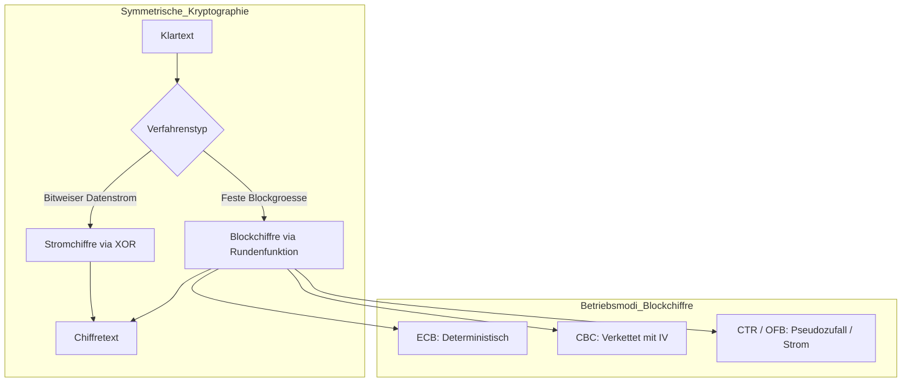

# KRYPTOG: Symmetrische Kryptographie
Dozent: Josef Schuler
Modul: Kryptologie (ICS.KRYPTOG, HS 26)
Tags: #Kryptographie #SymmetrischeVerschluesselung #Blockchiffre #Stromchiffre #Sicherheit

Diese Vorlesungseinheit behandelt die Kernkonzepte der symmetrischen Kryptographie mit dem Fokus auf Strom- und Blockchiffren. Neben den mathematischen Grundlagen wie XOR und Permutationen werden zentrale Betriebsmodi, Fehlerfortpflanzung sowie Mechanismen zum Integritätsschutz strukturiert analysiert.

### Kernprozess

### 1. Stromchiffren und das One-Time-Pad
- **Funktionsprinzip:** Klartextbits werden bitweise mit einem pseudozufälligen Schlüsselstrom mittels XOR addiert.
- **XOR-Eigenschaft:** Verschlüsselung und Entschlüsselung basieren auf derselben Operation, da doppeltes XOR den Ausgangswert wiederherstellt.
- **Integrität:** Stromchiffren bieten prinzipbedingt keine Datenintegrität oder Authentizität, da Bit-Manipulationen direkt den Klartext verändern.
- **One-Time-Pad (OTP):** Spezialfall einer Stromchiffre mit absolut zufälligem Schlüsselstrom gleicher Länge wie der Klartext; garantiert perfekte bzw. informationstheoretische Sicherheit.
- **Bekannte Vertreter:** ChaCha20, Salsa20, A5 (Mobilfunk) sowie das historisch anfällige RC4 (WEP).

### 2. Blockchiffren als Arbeitspferd der Kryptographie
- **Grundprinzip:** Feste Klartextblöcke werden über mehrere Runden durch schlüsselabhängige Permutationen bijektiv auf Chiffratblöcke gleicher Länge abgebildet.
- **Konfusion:** Verwischt den Zusammenhang zwischen Schlüssel und Chiffretext, meist realisiert über S-Boxen.
- **Diffusion:** Verteilt den Einfluss einzelner Klartext- oder Schlüsselbits über den gesamten Block (Lawineneffekt / Avalanche-Effekt).
- **Striktes Avalanche-Kriterium:** Jedes Ausgabebit ändert sich mit einer Wahrscheinlichkeit von genau 0.5, wenn sich ein einzelnes Eingabebit ändert.
- **Lightweight Cryptography:** Spezialisierte Blockchiffren wie PRESENT oder ASCON für IoT- und RFID-Systeme mit minimalem Energie- und Gatterbedarf.

### 3. Betriebsmodi von Blockchiffren
- **ECB-Modus (Electronic Codebook):** Jeder Block wird unabhängig verschlüsselt; parallelisierbar, aber unsicher, da identische Klartextblöcke identische Chiffratblöcke erzeugen.
- **CBC-Modus (Cipher Block Chaining):** Vor der Verschlüsselung wird jeder Block mit dem vorherigen Chiffratblock (bzw. dem Initialisierungsvektor IV) per XOR verknüpft; verhindert Blockmuster.
- **CTR-Modus (Counter Mode):** Blockchiffre verschlüsselt Zählerwerte zur Erzeugung eines Schlüsselstroms; kombiniert die Vorteile von Parallelisierbarkeit mit dem Vermeiden von Mustern.
- **OFB-Modus (Output Feedback):** Verwandelt die Blockchiffre durch rekursive Rückkopplung des Ausgangs in eine synchrone Stromchiffre.
- **Fehlerfortpflanzung:** Ein Bitfehler im CBC-Chiffrat zerstört den aktuellen Block komplett und kippt genau ein Bit im nachfolgenden Block, danach erholt sich die Entschlüsselung wieder.

### 4. Integritätsschutz und MAC-Verfahren
- **CBC-MAC:** Verwendet den CBC-Modus ohne Ausgabe von Zwischenblöcken; der letzte verschlüsselte Block dient als Message Authentication Code.
- **IV-Sicherheit beim CBC-MAC:** Der IV darf bei variabler Klartextlänge nicht beliebig wählbar im Klartext übertragen werden, da sonst Manipulationen im ersten Block kompensiert werden können.
- **AEAD:** Moderne Verfahren vereinen Vertraulichkeit und Integritätsschutz in einem einzigen kryptographischen Schritt (Authenticated Encryption).

### 5. Vergleich der kryptographischen Verfahren und Modi
| Verfahren / Modus | Typ | Parallelisierbar | Integritätsschutz | Hauptsächlicher Anwendungsbereich |
| :--- | :--- | :--- | :--- | :--- |
| OTP | Stromchiffre | Nein (sequentiell) | Nein | Höchste Geheimhaltung bei vorab geteiltem Zufall |
| ChaCha20 / Salsa20 | Stromchiffre | Ja (über Blockzähler) | Nein | Moderne Messenger (Wire, Signal, Threema) |
| AES-ECB | Blockchiffre | Ja (Ver- und Entschlüsselung) | Nein | Grundsätzlich obsolet für strukturierte Nutzdaten |
| AES-CBC | Blockchiffre | Nur Entschlüsselung | Nein | Klassische Transportverschlüsselung und Legacy-Netze |
| AES-CTR | Strommodus (Blockchiffre) | Ja (Ver- und Entschlüsselung) | Nein | Festplattenverschlüsselung, Hochgeschwindigkeitsnetze |
| CBC-MAC | Integritätsmechanismus | Nein (sequentielle Kette) | Ja | Authentizitätssicherung im Banken- und Finanzwesen |
| PRESENT | Lightweight Blockchiffre | Variantenabhängig | Nein | RFID, Smart Cards und ressourcenarme IoT-Sensoren |

### Wichtigste Key Takeaways
- **Verschlüsselung schützt ausschliesslich vor dem Abhören:** Weder Strom- noch Standard-Blockchiffren garantieren für sich genommen die Integrität oder Authentizität einer Nachricht.
- **Schlüsselwiederverwendung bricht Stromchiffren:** Wird derselbe Schlüsselstrom mehrfach verwendet, lassen sich Klartexte durch einfache XOR-Verknüpfung der Chiffrate gegeneinander offenlegen.
- **ECB-Modus ist kryptographisch unsicher für Datenstrukturen:** Da gleiche Klartextblöcke in identische Chiffratblöcke überführt werden, bleiben Muster und Konturen vollständig erkennbar.
- **CTR-Modus bietet die beste Flexibilität:** Er transferiert eine Blockchiffre in eine Stromchiffre und erlaubt wahlfreien Zugriff sowie vollständige Parallelisierung bei Ver- und Entschlüsselung.
- **Diffusion und Avalanche-Effekt sind Qualitätsmerkmale:** Eine starke Blockchiffre sorgt dafür, dass die Änderung eines einzigen Eingabebits statistisch die Hälfte aller Ausgabebits invertiert.