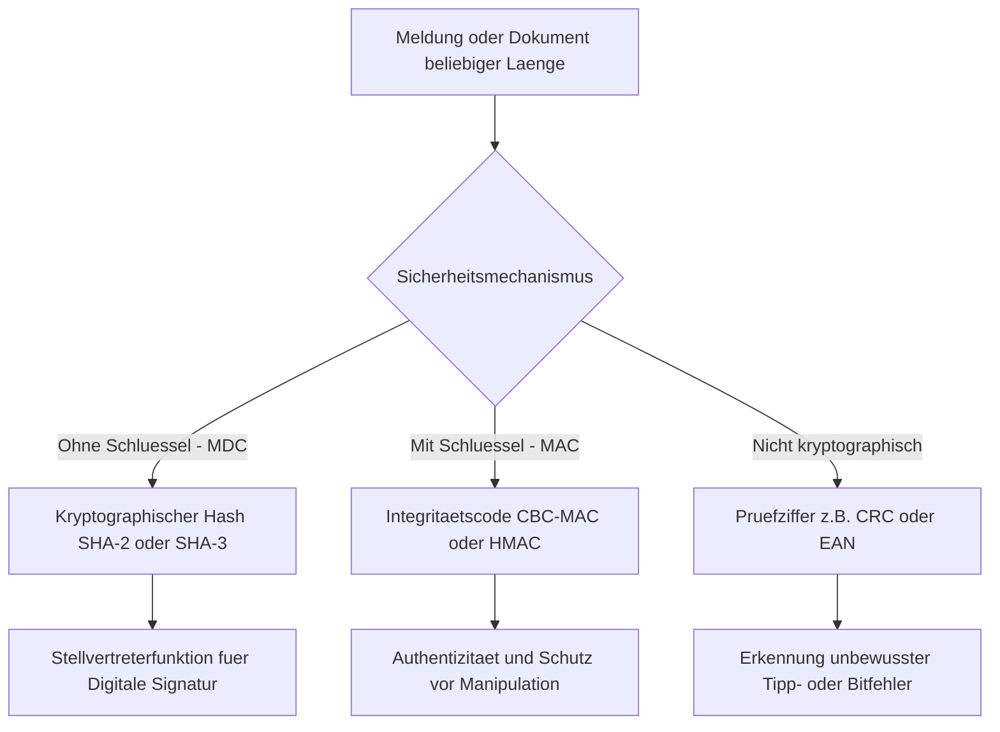

# KRYPTOG Präsenz 4: Einweg- und Hashfunktionen sowie MACs
Dozent: Josef Schuler
Modul: Kryptologie (ICS.KRYPTOG), HSLU
Tags: #Kryptologie #Hashfunktionen #MAC #HMAC #Einwegfunktionen #ITSecurity

Diese Vorlesungseinheit behandelt die mathematischen und praktischen Grundlagen von Einweg- und Hashfunktionen sowie Message Authentication Codes (MACs). Im Fokus stehen die Einordnung von Prüfziffern, kryptographischen Prüfwerten (MDC) und schlüsselabhängigen Integritätsmechanismen (CBC-MAC, HMAC) sowie die Analyse zentraler Sicherheits- und Angriffseigenschaften.

### Kernprozess

### 1. Klassifizierung und Definitionen
- **Einwegfunktion:** Funktion f, bei der die Vorwärtsberechnung y = f(x) effizient und in polynomialer Zeit durchführbar ist, die Invertierung x = f^(-1)(y) jedoch praktisch unmöglich bzw. rechnerisch nicht machbar ist.
    - Eine kryptographisch sichere Hashfunktion ist stets eine Einwegfunktion, jedoch ist nicht jede Einwegfunktion eine Hashfunktion (z. B. asymmetrische Falltürfunktionen oder KDFs).
    - Einwegfunktionen lassen sich in Varianten mit Falltür (Trapdoor) und ohne Falltür unterteilen.
- **Hashfunktion:** Bildet eine Eingabemenge beliebiger Bitlänge deterministisch auf eine feste, kleinere Bitlänge ab.
    - Typ 1 (Nicht kryptographisch, ohne Schlüssel): Einfache Prüfziffern (wie EAN-13, ISBN, Parity-Bit, CRC) zur Erkennung zufälliger Tipp- oder Übertragungsfehler.
    - Typ 2 (Kryptographisch sicher, mit Schlüssel): Message Authentication Codes (MAC) wie CBC-MAC oder HMAC zur Gewährleistung von Integrität und Schutz vor Insertion.
    - Typ 3 (Kryptographisch sicher, ohne Schlüssel): Manipulation Detection Code (MDC), gemeinhin als kryptographische Hashfunktion verstanden (z. B. SHA-2, SHA-3), primär als Stellvertreterfunktion für digitale Signaturen genutzt.

### 2. Übersicht der Funktions- und Angriffsarten
| Merkmal / Typ | Typ 1: Prüfziffer | Typ 2: MAC (CBC-MAC / HMAC) | Typ 3: MDC (Hashfunktion) |
| :--- | :--- | :--- | :--- |
| Schlüsseleinsatz | Schlüssellos | Symmetrischer geheimer Schlüssel | Schlüssellos |
| Primäres Schutzziel | Unbeabsichtigte Fehler | Bewusste Manipulation, Integrität | Stellvertreter für Signaturen |
| Sicherheitsmodul | Nicht erforderlich | Erforderlich (HSM / Secure Element) | Nicht erforderlich |
| Rechenaufwand | Extrem gering | Mittel bis hoch (abhängig vom Modul) | Sehr schnell in Software |
| Resistenz gegen Angreifer | Keine kryptographische Sicherheit | Hoch (durch Geheimnis geschützt) | Hoch (durch mathematische Eigenschaften) |

### 3. Sicherheitseigenschaften und Angriffsmodelle
- **Urbildresistenz (Pre-Image Resistance):** Gegeben y; es ist rechnerisch unmöglich, ein x zu finden, sodass h(x) = y gilt.
    - Auch als fundamentale Einwegeigenschaft definiert.
    - Aufwand für Brute-Force liegt bei O(2^n).
- **Schwache Kollisionsresistenz (2nd Pre-Image Resistance):** Gegeben x; es ist rechnerisch unmöglich, ein x' ungleich x zu finden, sodass h(x) = h(x') gilt.
    - Ziel eines Angreifers beim Fälschen eines bestehenden signierten Dokuments.
    - Aufwand beträgt O(2^n).
- **Starke Kollisionsresistenz (Collision Resistance):** Es ist rechnerisch unmöglich, zwei beliebige Werte x und x' (x ungleich x') zu finden, für die h(x) = h(x') gilt.
    - Mathematisch durch das Geburtstagsparadoxon bestimmt; der Angriffsaufwand sinkt drastisch auf O(2^(n/2)).
    - Eine Funktion, die starke Kollisionsresistenz erfüllt, erfüllt automatisch auch schwache Kollisionsresistenz.
- **Lawineneffekt (Avalanche Effect):** Die Änderung eines einzigen Bits in der Eingabe bewirkt, dass sich jedes Bit im Ausgangshash mit einer Wahrscheinlichkeit von 0.5 ändert.
    - Statistisch ändern sich im Mittel exakt 50 Prozent der Ausgabebits.

### 4. Konstruktionen: CBC-MAC und HMAC
- **CBC-MAC:** Basiert auf einer Blockchiffre im Cipher Block Chaining Modus; der MAC entspricht dem letzten verschlüsselten Block.
    - Ohne standardisierten festen Initialisierungsvektor (IV = 0) anfällig für Modifikationen des ersten Blocks durch XOR-Kompensation.
    - Erfordert saubere Längenbehandlung bzw. Padding (z. B. Bit-Padding 10...00 oder CMAC), da variable Längen ohne Längenfeld im Header Angriffe erlauben.
    - ANSI X9.19 (ISO 9797-1 Algorithmus 3) erhöht die Sicherheit durch eine zweistufige Triple-DES-Endstufe (Encrypt-Decrypt-Encrypt).
- **HMAC (RFC 2104):** Schlüsselabhängige MAC-Konstruktion auf Basis kryptographischer Hashfunktionen ohne Modifikation des Hash-Algorithmus.
    - Nutzt zwei Padding-Konstanten: ipad (0x36 wiederholt) und opad (0x5C wiederholt).
    - Formel: HMAC(x) = h((k XOR opad) || h((k XOR ipad) || x)).
    - Weit verbreitet in TLS, IPsec und WireGuard; dient auch als Pseudozufallsfunktion (PRF) und Schlüsselableitungsfunktion (KDF).

### 5. Einwegfunktionen in der asymmetrischen Kryptographie
- **Mit Falltür (Trapdoor One-Way Function):** Invertierung ist extrem aufwendig, außer man besitzt eine geheime Zusatzinformation.
    - RSA: Potenzierung mod N ist einfach; e-te Wurzel mod N ist ohne Kenntnis der Primfaktoren p und q von N unlösbar.
- **Ohne Falltür:** Invertierung ist für alle Beteiligten gleichermaßen unmöglich.
    - Diffie-Hellman: Diskreter Logarithmus in endlichen Körpern.
    - Elliptische Kurven (ECC): Bestimmung des Skalars k aus dem Gruppenpunkt Q = k * P.
- **Einwegpermutation:** Bijektive Einwegfunktion, welche die Definitionsmenge bijektiv auf sich selbst abbildet (Permutation der Zustände).

### Wichtigste Key Takeaways
- **Einwegfunktionen sind der Oberbegriff:** Jede sichere kryptographische Hashfunktion ist eine Einwegfunktion, aber asymmetrische Falltürfunktionen oder Schlüsselableitungen sind keine Hashfunktionen.
- **MDC vs. MAC:** Ein MDC (schlüsselloser Hash) liefert isoliert betrachtet keine Integrität gegen aktive Angreifer, da er neu berechnet werden kann; erst digitale Signaturen oder geheime Schlüssel (MAC) garantieren Authentizität.
- **Geburtstagsparadoxon erzwingt Bitlängen:** Aufgrund des reduzierten Aufwands von O(2^(n/2)) bei Kollisionsangriffen fordern aktuelle Richtlinien für Signaturen mindestens 256 Bit Ausgabelänge (effektiv mindestens 128 Bit Sicherheit).
- **HMAC als universeller Baustein:** Durch die geschachtelte Konstruktion schützt HMAC vor Length-Extension-Angriffen und fungiert in modernen Protokollen als PRF und KDF.