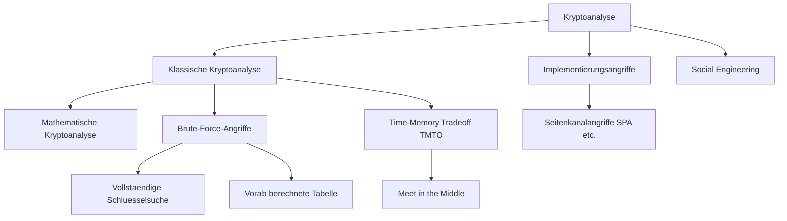

# KRYPTOG Präsenz 5: Kryptoanalyse mit Schwerpunkt symmetrische Kryptographie
Dozent: Josef Schuler
Modul: Kryptologie (ICS.KRYPTOG)
Tags: #Kryptologie #Kryptoanalyse #SymmetrischeKryptographie #BruteForce #TMTO #DES #AES #SideChannel

Diese Vorlesungseinheit vermittelt eine Einführung in die klassische Kryptoanalyse von symmetrischen Kryptosystemen und Blockchiffren. Behandelt werden fundamentale Angriffsmodelle, Brute-Force-Verfahren, Time-Memory-Tradeoffs wie die Meet-in-the-Middle-Attacke sowie Implementierungsangriffe und der Vergleich zu Quantencomputern. Zentraler Leitsatz ist, dass die Unmöglichkeit von Brute Force eine notwendige, jedoch keinesfalls hinreichende Bedingung für die praktische Sicherheit eines Kryptosystems darstellt.

### Kernprozess

### 1. Grundlagen und Sicherheitsbegriffe
- **Sicherheitsdefinition nach Kerckhoffs:** Das System muss so konzipiert sein, dass alle Parameter und Algorithmen öffentlich bekannt sein dürfen; einzig der geheime Schlüssel muss geschützt werden.
- **Informationstheoretische Sicherheit:** Ein Kryptosystem gilt als perfekt sicher, wenn es selbst gegenüber einem Angreifer mit unbeschränkten Rechen- und Zeitressourcen resistent ist (z. B. One-Time-Pad).
- **Berechenmässige Sicherheit:** Das System gilt als sicher unter der realistischen Annahme beschränkter Rechenkapazitäten, da der Berechnungsaufwand für einen erfolgreichen Angriff ökonomisch oder technisch nicht machbar ist.
- **Sicherheits-Slogan:** Eine Chiffre ist nicht automatisch sicher, nur weil Brute Force unmöglich ist; die Unmöglichkeit von Brute Force ist notwendig, aber nicht hinreichend.

### 2. Klassische Angriffsmodelle (Attacken)
- **Ciphertext-only Attacke:** Der Angreifer belauscht lediglich den unsicheren Übertragungskanal und verfügt ausschließlich über abgefangene Chiffrate mit dem Ziel, Klartexte oder den Schlüssel abzuleiten.
- **Known-plaintext Attacke:** Dem Kryptoanalytiker stehen korrespondierende Paare aus Klartext und Geheimtext zur Verfügung (z. B. durch standardisierte Protokoll-Header oder wiederkehrende Begrüßungsfloskeln).
- **Chosen-plaintext Attacke:** Der Angreifer kann beliebige Klartexte über ein zugängliches Kryptogerät bzw. eine Orakelfunktion verschlüsseln lassen und die resultierenden Chiffrate analysieren, um den Schlüssel zu extrahieren.
  - Bei asymmetrischen Kryptosystemen ist dieser Angriffstyp stets anwendbar, da der Verschlüsselungsschlüssel prinzipbedingt öffentlich zugänglich ist.

### 3. Mathematisches Exempel: Affine Chiffre
- **Definition:** Basiert auf der linearen Kongruenz y = (a * x + b) mod m, wobei ggT(a, m) = 1 erfüllt sein muss, damit a in Z_m invertierbar ist.
- **Schlüsselraum:** Für das englische Alphabet mit m = 26 existieren phi(26) = 12 teilerfremde Werte für a und 26 Werte für b, was total 312 Schlüsselvarianten ergibt (bzw. 275 nichttriviale Schlüssel ohne Identitätsabbildungen).
- **Modul-Variationen:**
  - Die Wahl einer Primzahl wie mod 23 reduziert das Alphabet fehlerhaft (Überlappung von Zeichen).
  - Ein Modul von mod 31 erfordert zwingend das Hinzufügen weiterer definierter Sonderzeichen zum Alphabet, um Eindeutigkeit zu gewährleisten.

### 4. Brute-Force-Verfahren und Time-Memory Tradeoffs (TMTO)
- **Vollständige Schlüsselsuche (Exhaustive Key Search):** Known-plaintext-Methode, die systematisch alle k möglichen Schlüssel durchprobiert; der durchschnittliche Suchaufwand bei Gleichverteilung liegt bei k/2 Operationen.
- **Vorab berechnete Tabelle (Table Lookup):** Chosen-plaintext-Methode mit k vorberechneten Tabelleneinträgen; der Zeitaufwand beim Angriff reduziert sich auf eine einfache Datenbankabfrage, erfordert jedoch enormen Speicherplatz.
- **Meet-in-the-Middle-Attacke:** Ein spezieller TMTO für Mehrfachverschlüsselungen; Klartext wird vorwärts verschlüsselt, Chiffrat rückwärts entschlüsselt und die Zwischenwerte werden verglichen.
  - Beim Doppel-DES reduziert sich der effektive Aufwand von geglaubten 112 Bit auf 2^57 Rechenschritte und 2^56 Speichereinträge (Sicherheitsgewinn von lediglich 1 Bit).
  - Bei 3DES mit 3 Schlüsseln sinkt die effektive Sicherheitsmarge von 168 Bit auf rund 112 Bit.
- **Resistenz gegen Quantencomputer:** Quantencomputer (Grover-Algorithmus) reduzieren die Komplexität auf die Quadratwurzel k^(1/2). Symmetrische Blockchiffren sind dennoch deutlich robuster als asymmetrische Verfahren; AES-256 bleibt mit 128 Bit Reststärke quantensicher.

### 5. Vergleich kryptographischer Angriffsarten und Komplexitäten
| Verfahren / Kontext | Formaler Typ | Theoretischer Schlüsselraum | Effektiver Angriffsaufwand | Bemerkung |
| :--- | :--- | :--- | :--- | :--- |
| Exhaustive Key Search | Brute Force | k = 2^n | k Operationen (k/2 im Mittel) | Minimaler Speicherbedarf, hoher Zeitaufwand |
| Table Look-up | Brute Force | k = 2^n | 1 Operation (nach Vorberechnung) | Extrem hoher Speicherbedarf (k Einträge) |
| Doppel-DES | Meet in the Middle (TMTO) | 2^112 | ca. 2^57 Operationen | Sicherheit steigt gegenüber 1-DES nur um 1 Bit |
| 3DES (2 Schlüssel) | TMTO | 2^112 | ca. 2^60 Operationen | Geringfügiger Sicherheitsgewinn |
| 3DES (3 Schlüssel) | Meet in the Middle (TMTO) | 2^168 | ca. 2^112 Operationen | Gilt regulatorisch bis 2030 als hinreichend |
| AES-128 (Klassisch / TMTO) | Merkle-Hellman TMTO | 2^128 | ca. 2^85 (k^2/3) bis 2^43 (k^1/3) | Heuristische Abschätzungen |
| AES-128 (Quantencomputer) | Grover-Algorithmus | 2^128 | ca. 2^64 (Quadratwurzel) | 128-Bit-Schlüssel reichen gegen QC nicht aus |
| Simple Power Analysis (SPA) | Implementierungsangriff | Variabel | Nicht abhängig von k | Misst Stromprofil während Rechenoperationen |

### 6. Implementierungsangriffe und Seitenkanäle
- **Seitenkanalangriffe (Side Channel Attacks):** Nutzen physikalische Messgrössen realer Hardware aus, anstatt die mathematische Struktur anzugreifen (z. B. Stromverbrauch, elektromagnetische Abstrahlung, Rechenzeit oder optische LED-Aktivitäten).
- **Simple Power Analysis (SPA):** Weist geheime Schlüsselbits (z. B. bei RSA) durch Leistungsunterschiede zwischen Multiplikations- und Quadrierungsschritten nach.
- **PIN-Retry-Angriff:** Frühe Smartcards initiierten nach falscher PIN-Eingabe einen stromintensiven Schreibvorgang zum Dekrementieren des Fehlerzählers; gezieltes Abschalten vor dem Schreiben verhinderte die Kartensperrung.
  - Abhilfe: Vorab-Dekrementierung des Zählers zu Beginn der Verifikation, der erst nach erfolgreicher Validierung wieder zurückgesetzt wird.

### Wichtigste Key Takeaways
- **Brute-Force-Resistenz reicht nicht aus:** Mathematisch unknackbare Algorithmen können durch Implementierungsschwächen, Seitenkanäle oder TMTO-Verfahren kompromittiert werden.
- **Mehrfachverschlüsselung verdoppelt nicht die Schlüssellänge:** Durch Meet-in-the-Middle-Angriffe bietet Doppel-DES kaum mehr Schutz als Single-DES; 3DES mit 3 Schlüsseln erreicht lediglich 112 Bit effektive Sicherheit.
- **Asymmetrische Kryptosysteme sind per se anfällig für Chosen-Plaintext:** Da öffentliche Schlüssel frei zugänglich sind, kann jeder Angreifer beliebige Texte selbst verschlüsseln.
- **Quantencomputer halbieren effektive Bitlängen symmetrischer Verfahren:** Grover-Attacken reduzieren den Suchaufwand auf die Wurzel der Schlüsselraumgrösse, weshalb langfristig 256-Bit-Schlüssel (wie bei AES-256) zwingend erforderlich sind.