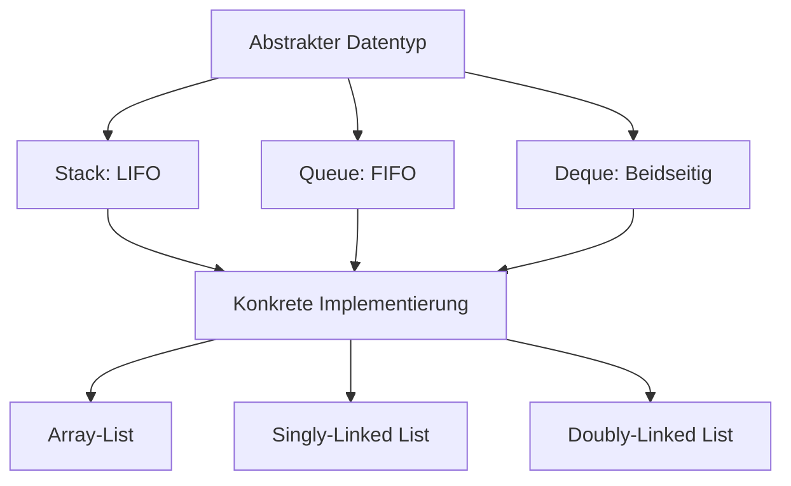

# 02 - Lineare Datenstrukturen
Dozent: Th. Letsch
Modul: Algorithmen & Datenstrukturen (HSLU:ICS/AIML / HS26)
Tags: #Datenstrukturen #Algorithmen #LinkedList #Stack #Queue #Deque #Iterator

Diese Vorlesungseinheit behandelt die Grundlagen und Implementierungsdetails linearer Datenstrukturen wie Array-Lists, einfach und doppelt verkettete Listen sowie deren Einsatz in abstrakten Datentypen wie Stacks, Queues und Deques. Zudem wird das Konzept des Iterators zur sequenziellen Traversierung vorgestellt und bezüglich Laufzeit sowie Sprachunterschieden zwischen Java und Python analysiert.

### Kernprozess

### 1. Listen-Datenstrukturen
- **Array-List:** Kapselt ein dynamisches Array, welches die Kapazität bei Überlauf automatisch verdoppelt und bei Löschungen verkleinert.
    - Zugriff über Index erfolgt in konstanter Zeit O(1).
    - Einfügen an beliebiger Stelle oder bei Kapazitätsüberlauf erfordert Umkopieren in O(n).
- **Singly-Linked-List:** Sequenz von Knoten (Nodes), wobei jeder Knoten den Nutzwert (Element) und eine Referenz auf den nächsten Knoten (next) hält.
    - Startknoten wird als Head referenziert, das Ende als Tail.
    - Einfügen und Löschen am Kopf (addFirst, removeFirst) benötigt nur O(1) Zeit.
- **Doubly-Linked-List:** Knoten besitzen zusätzlich eine Referenz auf den Vorgänger (prev).
    - Beseitigt die Einschränkung der einfachen Richtungssuche auf Kosten von mehr Speicherplatz pro Knoten.
    - Verwendet oft Sentinel-Knoten (Header und Trailer) als Randbegrenzungen, um Randfallprüfungen zu vereinfachen.

### 2. Iteratoren
- **Iterator-Konzept:** Abstrahiert das schrittweise Durchlaufen einer Datensammlung über die Kernoperation next().
- **Implementierungsunterschiede:**
    - In Python erzeugt über iter() und durchlaufen mit next(), Signalisation des Endes via StopIteration. Modifikationen während der Iteration sind möglich.
    - In Java erzeugt über iterator(), geprüft via hasNext() und abgerufen mit next(). Modifikationen der Collection währenddessen lösen eine ConcurrentModificationException aus.

### 3. Abstrakte Datentypen (ADTs): Stack, Queue und Deque
- **Stack (LIFO):** Last-In-First-Out-Prinzip (vergleichbar mit einem Tellerstapel).
    - Kernoperationen: push(Object) zum Einfügen und pop() zum Entfernen und Auslesen des obersten Elements.
    - Hilfsoperationen: top() (liest oberstes Element ohne Entfernen), size(), isEmpty().
    - Anwendungsbereiche: Browser-Verlauf, Undo-Mechanismen, Rekursion und Call-Stack der Laufzeitumgebung.
- **Queue (FIFO):** First-In-First-Out-Prinzip (vergleichbar mit einer Warteschlange).
    - Kernoperationen: enqueue(Object) am Ende einfügen, dequeue() am Anfang entnehmen.
    - Hilfsoperation: first() liefert das vorderste Element ohne Löschen.
    - Anwendungsbereiche: Druckaufträge, Multithreading, Warteschlangen von Ressourcen.
- **Deque (Double-Ended Queue):** Erlaubt Einfügen und Entfernen an beiden Enden (Head und Tail).
    - Bietet Operationen wie addFirst(), addLast(), removeFirst(), removeLast(), first(), last().
    - Wird optimal mit einer Doubly-Linked-List implementiert, wodurch alle Operationen in O(1) ablaufen.

### 4. Komponenten- und Laufzeitvergleich
| Datenstruktur / Operation | get(index) | addFirst() | addLast() | addAfter(u, v) | remove(index) | Java-Klasse | Python-Aquivalent |
| :--- | :--- | :--- | :--- | :--- | :--- | :--- | :--- |
| Array-List | O(1) | O(n) | O(1) amortisiert / O(n) | O(n) | O(n) | java.util.ArrayList | list |
| Singly-Linked-List | O(n) | O(1) | O(1) mit Tail | O(1) | O(n) | - | - |
| Doubly-Linked-List | O(n) | O(1) | O(1) | O(1) | O(n) / O(1) per Node | java.util.LinkedList | collections.deque |

### Wichtigste Key Takeaways
- **Wahl der Listenform bestimmt Flaschenhälse:** Array-Lists glänzen beim wahlfreien Indexzugriff in O(1), während verlinkte Listen Vorteile bei Einfüge- und Löschoperationen an den Rändern in O(1) bieten.
- **Sentinel-Knoten vereinfachen Logik:** Durch feste Header- und Trailer-Knoten in Doubly-Linked-Lists entfallen Sonderfallbehandlungen für leere Listen beim Einfügen und Löschen.
- **LIFO versus FIFO:** Stacks eignen sich für Umkehr- und Rückverfolgungsprozesse (Undo, Call-Stack), während Queues faire Verarbeitungsreihenfolgen bei geteilten Ressourcen abbilden.
- **Deque als Allrounder:** Die Double-Ended Queue vereint die Funktionalitäten von Stack und Queue und erzielt mit einer Doubly-Linked-List für alle Randoperationen O(1)-Laufzeit.