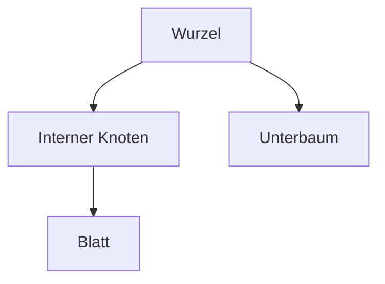

# 03 - Trees / Bäume
Dozent: Th. Letsch
Modul: Algorithmen & Datenstrukturen / HS26
Tags: #Algorithmen #Datenstrukturen #Trees #Baeume #Informatik

Baeume repräsentieren abstrakte, hierarchische Strukturen in der Informatik und bestehen aus Knoten, die in Eltern-Kind-Relationen zueinander stehen. Sie finden vielfältige Anwendungen in Dateisystemen, Organigrammen, Programmierumgebungen sowie bei der Auswertung arithmetischer Ausdrücke.

### Kernprozess

### 1. Grundbegriffe und Terminologie
- **Wurzel:** Der oberste Knoten eines Baumes ohne Elternknoten.
- **Interner Knoten:** Ein Knoten, der mindestens ein Kind besitzt.
- **Externer Knoten:** Ein Knoten ohne Kinder, auch Blatt genannt.
- **Tiefe eines Knotens:** Die Anzahl der Vorgänger beziehungsweise die Anzahl der Kanten von der Wurzel bis zum Knoten.
- **Höhe eines Baums:** Die maximale Tiefe aller Knoten im Baum.

### 2. Abstrakte Datentypen
- **Tree ADT:** Nutzt Positionen als Abstraktion für Knoten und bietet Methoden zur Verwaltung von Eltern und Kindern.
- **BinaryTree ADT:** Erweitert den Tree ADT und fügt spezifische Methoden für ein linkes und rechtes Kind hinzu.

### 3. Speicherverfahren für Bäume
| Speicherverfahren             | Beschreibung und Eigenschaften                                                                         |
| :---------------------------- | :----------------------------------------------------------------------------------------------------- |
| **Verlinkte Baum-Knoten**     | Knoten speichern Referenzen auf das Element, den Elternknoten sowie auf die Kindknoten.                |
| **Array-basiertes Verfahren** | Speicherung in einem Array, wobei Indizes über Formeln für das linke und rechte Kind berechnet werden. |

### 4. Baum-Traversierungen
- **Preorder:** Ein Knoten wird vor seinen Nachfolgern besucht.
- **Postorder:** Ein Knoten wird nach seinen Nachfolgern besucht.
- **Breadth-First:** Knoten werden ebenenweise von oben nach unten besucht.
- **Inorder:** Ein Knoten wird nach seinem linken und vor seinem rechten Unterbaum besucht.

### Wichtigste Key Takeaways
- **Hierarchische Modellierung:** Bäume bilden komplexe Eltern-Kind-Beziehungen und Strukturen wie Dateisysteme effizient ab.
- **Rekursive Natur:** Operationen wie Höhenbestimmung und Traversierungen lassen sich elegant rekursiv implementieren.
- **Flexible Speicherung:** Je nach Bedarf können Bäume über Zeiger oder kompakt in Arrays repräsentiert werden.