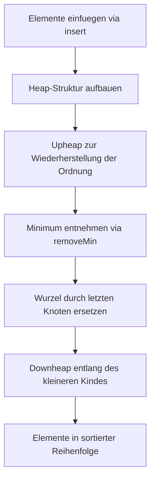

# SW 04 - Priority-Queues und Heaps
Dozent: Th. Letsch
Modul: Algorithmen & Datenstrukturen (HSLU:ICS/AIML)
Tags: #Algorithmen #Datenstrukturen #PriorityQueue #Heap #HeapSort #HSLU

Diese Vorlesungseinheit behandelt die Funktionsweise und Implementierung von Vorrangwarteschlangen (Priority Queues), deren Realisierung über sequenzbasierte Ansätze sowie binäre Heaps. Zudem werden die Sortiermethode Heap-Sort und erweiterte Konzepte wie die Adaptable Priority Queue mittels Location-Aware Entries vertieft.

### Kernprozess

### 1. Grundlagen der Priority Queue
- **Priority Queue:** Ein abstrakter Datentyp, der eine Sammlung von Einträgen speichert, wobei jedes Element aus einem Schlüssel-Wert-Paar besteht.
- **Entry:** Paarung aus Schlüssel (Key) zur Priorisierung und dem eigentlichen Nutzwert (Value).
- **Kernoperationen:**
  - **insert(k, v):** Fügt einen neuen Eintrag mit Schlüssel k und Wert v in die Warteschlange ein.
  - **removeMin():** Entfernt den Eintrag mit dem kleinsten Schlüssel und gibt diesen zurück.
  - **min():** Liefert den kleinsten Eintrag ohne Entfernen.
  - **size() und isEmpty():** Abfragen über den aktuellen Füllstand der Datenstruktur.
- **Typische Anwendungsbereiche:** Warteschlangensysteme, Börsenhandel und Auktionsplattformen.

### 2. Sequenzbasierte Implementierungen
- **Unsortierte Liste:**
  - **Einfügen:** Erfolgt in konstanter Zeit O(1) am Anfang oder Ende.
  - **Entfernen:** Das Suchen des kleinsten Schlüssels erfordert einen linearen Durchlauf in O(n).
  - **Sortierbezug:** Führt beim vollständigen Sortieren zum Verfahren Selection-Sort.
- **Sortierte Liste:**
  - **Einfügen:** Erfordert das Auffinden der korrekten Einfügestelle in linearer Zeit O(n).
  - **Entfernen:** Das kleinste Element befindet sich direkt am Anfang und wird in O(1) entnommen.
  - **Sortierbezug:** Entspricht im Sortierablauf dem klassischen Insertion-Sort.

### 3. Der binäre Heap
- **Heap-Definition:** Ein Binärbaum mit definierter Heap-Ordnung und speziellen strukturellen Eigenschaften.
- **Heap-Ordnung:** Für jeden Knoten v (ausser der Wurzel) gilt, dass der Schlüssel des Elternknotens kleiner oder gleich dem Schlüssel von v ist. Die Wurzel enthält somit stets das Minimum.
- **Struktureigenschaften:**
  - Alle Ebenen bis zur Tiefe h-1 sind vollständig mit Knoten besetzt.
  - Auf der tiefsten Ebene h werden die Knoten lückenlos von links nach rechts aufgefüllt.
  - Es existiert maximal ein Knoten mit genau einem Kind, welches zwingend ein linkes Kind sein muss.
  - Ein Heap mit n Knoten besitzt eine logarithmische Höhe von O(log n).

### 4. Heap-Operationen und Heap-Sort
- **Einfügen und Upheap:**
  - Der neue Schlüssel wird am nächsten freien Blatt (Einfüge-Knoten) eingefügt.
  - **Upheap:** Falls die Ordnung verletzt ist, wird der Schlüssel entlang des Pfades zur Wurzel mit den Elternknoten getauscht, solange der Elternknoten grösser ist. Die Laufzeit beträgt O(log n).
- **Entfernen und Downheap:**
  - Die Wurzel wird entfernt und durch den am weitesten rechts stehenden Knoten der tiefsten Ebene (letzter Knoten) ersetzt.
  - **Downheap:** Der neue Wurzelschlüssel wird nach unten getauscht, jeweils in Richtung des kleineren Kindes, bis die Heap-Ordnung wiederhergestellt ist. Die Laufzeit beträgt O(log n).
- **Heap-Sort:** Sortieralgorithmus, der n Elemente via insert() in den Heap einfügt und sequenziell via removeMin() ausliest. Dies resultiert in einer Gesamtlaufzeit von O(n log n).

### 5. Adaptable Priority Queue
- **Erweiterte Funktionalität:** Erlaubt die nachträgliche Modifikation von Schlüsseln und Werten bereits eingefügter Einträge sowie das gezielte Löschen beliebiger Elemente.
- **Erweiterte Methoden:**
  - **remove(e):** Entfernt einen spezifischen Eintrag e direkt aus der Datenstruktur.
  - **replaceKey(e, k):** Ersetzt den Schlüssel von e durch k und stellt die Ordnung wieder her.
  - **replaceValue(e, v):** Ersetzt den gespeicherten Wert eines Eintrags in O(1).
- **Location-Aware Entries:** Einträge speichern Back-Referenzen oder Indizes auf ihre genaue Position im Heap bzw. in der Liste, wodurch der Knoten in O(1) adressiert werden kann.

### 6. Laufzeitvergleich der Implementierungsansätze
| Operation | Unsortierte Liste | Sortierte Liste | Heap |
| :--- | :--- | :--- | :--- |
| size(), isEmpty() | O(1) | O(1) | O(1) |
| min() | O(n) | O(1) | O(1) |
| insert() | O(1) | O(n) | O(log n) |
| removeMin() | O(n) | O(1) | O(log n) |
| remove(e) | O(1) | O(1) | O(log n) |
| replaceKey(e, k) | O(1) | O(n) | O(log n) |
| replaceValue(e, v) | O(1) | O(1) | O(1) |

### Wichtigste Key Takeaways
- **Effizienz durch Heaps:** Ein binärer Heap balanciert Einfüge- und Entfernungszeiten optimal mit O(log n) aus und übertrifft einfache Listenansätze bei gemischten Operationen deutlich.
- **Minimales Wurzelelement:** Durch die Heap-Ordnung liegt das kleinste Element stets an der Wurzel, was den Zugriff auf das Minimum in konstanter Zeit O(1) ermöglicht.
- **Robuster Sortierstandard:** Heap-Sort nutzt den Heap-Mechanismus für eine garantierte Gesamtlaufzeit von O(n log n) ohne ungünstige Worst-Case-Einbrüche.
- **Flexibilität dank Back-Referenzen:** Location-Aware Entries machen Priority Queues anpassbar (adaptable), da Schlüsseländerungen ohne vorheriges lineares Suchen direkt in O(log n) verarbeitet werden können.