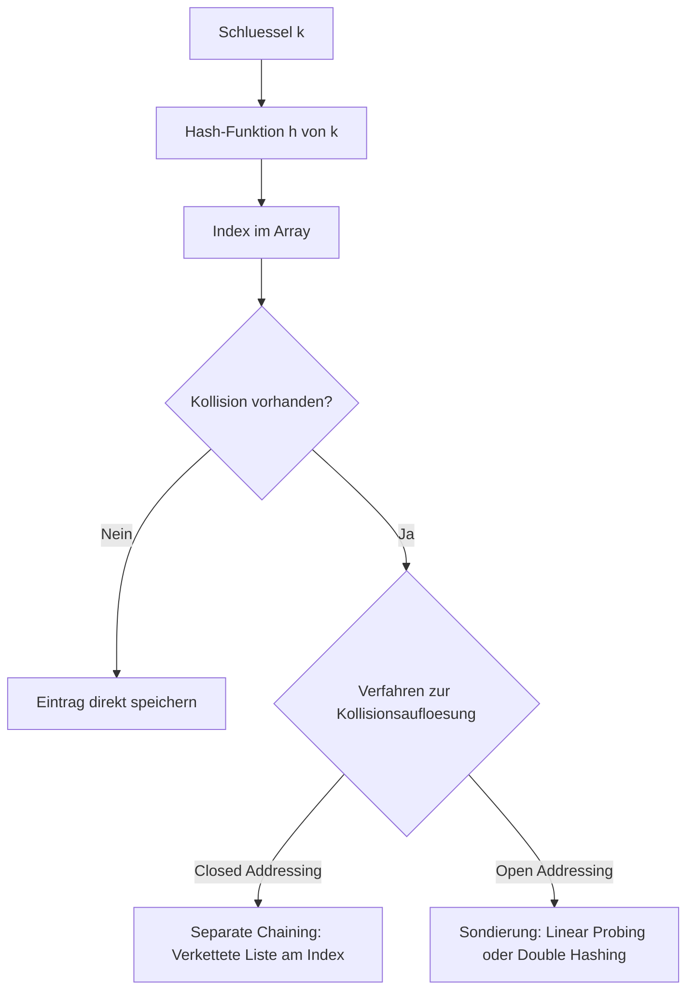

# 05 - Sets, Maps und Hashtables
Dozent: Th. Letsch
Modul: Algorithmen & Datenstrukturen (HSLU: ICS/AIML)
Tags: #Algorithmen #Datenstrukturen #Maps #Sets #Hashtable #Hashing

Diese Lerneinheit vermittelt die theoretischen Grundlagen und praktischen Umsetzungen von assoziativen Datenstrukturen wie Sets, Maps, Multisets und Multimaps. Im Fokus stehen der Entwurf und die Performance von Listen-basierten Maps sowie Hash-Tabellen unter Berücksichtigung verschiedener Kollisionsstrategien und Sprachkonventionen.

### Kernprozess

### 1. Datenstrukturen im Überblick
- **Map:** Modelliert eine durchsuchbare Collection von Schlüssel-Wert-Paaren (Key-Value-Entries), bei der jeder Schlüssel maximal einmal vorkommen darf.
- **Set:** Eine Collection einzigartiger Elemente ohne Duplikate, konzeptionell vergleichbar mit den Schlüsseln einer Map ohne zugeordnete Werte.
- **Multiset (Bag):** Eine mengenartige Sammlung, in der Duplikate bzw. Mehrfacheinträge explizit erlaubt sind.
- **Multimap (Dictionary):** Eine Assoziation, bei der ein einzelner Schlüssel auf mehrere Werte verweisen kann.
    - Realisierung meist über Collections als Werte oder angepasste interne Speicherstrukturen.

### 2. Vergleich der ADT-Varianten
| Datenstruktur | Schlüssel eindeutig? | Werte / Elemente | Typische Operationen |
| :--- | :--- | :--- | :--- |
| Set | Ja (nur Elemente) | Keine Values, keine Duplikate | add, remove, contains, union, intersect |
| Multiset (Bag) | Nein | Duplikate von Elementen erlaubt | add, remove, count, iterator |
| Map | Ja (Keys strikt unique) | Genau ein Wert pro Schlüssel | put, get, remove, keySet, values |
| Multimap | Nein (Mehrfach-Keys) | Mehrere Werte pro Schlüssel | put, get, remove, removeAll, entries |

### 3. Implementierungsansätze für Maps
- **Listen-basierte Map:** Speichert Schlüssel-Wert-Paare in einer unsortierten, doppelt verketteten Liste.
    - **Laufzeit:** Sämtliche Kernoperationen wie get, put und remove erfordern im Worst Case und Average Case einen linearen Durchlauf mit O(n).
    - **Einsatz:** Eignet sich ausschließlich für kleine Datenmengen.
- **Hash-Tabelle:** Implementiert die Map mittels eines Arrays fester Größe N und einer Berechnungsfunktion.
    - **Hash-Funktion:** Berechnet einen Hash-Code und bildet diesen über Modulo in das Intervall [0, N-1] ab.
    - **Performance:** Im Erwartungswert O(1) für Suchen, Einfügen und Löschen; sinkt im Worst Case (alle kollidieren) auf O(n).
    - **Lastfaktor (Alpha):** Verhältnis von gespeicherten Einträgen zur Tabellengröße N; steuert automatische Rehash-Vorgänge.

### 4. Kollisionsbehandlung
- **Separate Chaining (Closed Addressing):** Jede Zelle des Arrays referenziert eine verkettete Liste, die alle kollidierenden Elemente aufnimmt.
    - Vorteil: Einfache und robuste Handhabung.
    - Nachteil: Zusätzliche dynamische Speicherstrukturen außerhalb des Arrays erforderlich.
- **Linear Probing (Open Addressing):** Sucht bei belegtem Index zirkulär nach der nächsten freien Speicherzelle im Array.
    - Varianten: Vorwärts-/Rückwärtssuche oder quadratische Sondierung zur Reduktion von Clusterbildung.
- **Double Hashing (Open Addressing):** Verwendet bei einer Kollision eine sekundäre Hash-Funktion zur Bestimmung der variablen Schrittweite für die Sondierung.

### 5. Sprachspezifische Kontrakte
- **Java (equals & hashCode):** Wird die Methode equals() überschrieben, muss zwingend auch hashCode() überschrieben werden, damit gleiche Objekte identische Hash-Codes besitzen.
- **Python (__eq__ & __hash__):** Äquivalentes Prinzip über Magic Methods; benutzerdefinierte Klassen müssen beide Methoden konsistent implementieren, um als Schlüssel nutzbar zu sein.

### Wichtigste Key Takeaways
- **Effizienzsprung:** Hash-Tabellen reduzieren den Zugriff von O(n) bei Listen im Mittel auf O(1).
- **Kollisionsstrategie entscheidet:** Separate Chaining nutzt Zusatzlisten, während Open Addressing direkt im Array sondiert.
- **Kontrakt-Treue:** Konsistenz zwischen Gleichheitsprüfung und Hash-Code ist zwingend erforderlich, um Datenverlust in Hash-Collections zu verhindern.