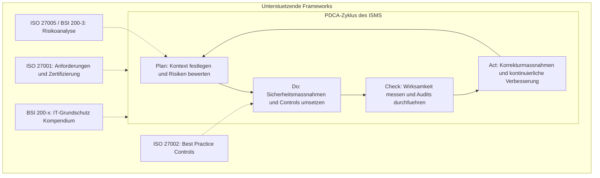

# 02 Standards & Frameworks I (ISO, BSI)
Dozent: Daniel Frei
Modul: Information Security Management (ISM)
Tags: #InformationSecurity #ISMS #ISO27001 #ISO27002 #ISO27005 #BSI #ITGrundschutz

Diese Vorlesung vermittelt die Grundlagen, Strukturen und praktischen Implementierungsansätze von Informationssicherheits-Managementsystemen (ISMS) anhand der internationalen Normenreihe ISO/IEC 27000 sowie der BSI-Standards 200-x des Bundesamts für Sicherheit in der Informationstechnik. Es wird aufgezeigt, wie Governance, Risikoanalysen und konkrete Kontrollkataloge ineinandergreifen, um Werte und Prozesse einer Organisation nachhaltig zu schützen.

### Kernprozess

### 1. Grundlagen des Information Security Managements (ISMS)
- **Die drei Säulen:** Informationssicherheit stützt sich zwingend auf Technik (kaufen und konfigurieren), Prozesse (definieren und kontrollieren) sowie Menschen (sensibilisieren und ausbilden).
- **Management-Verantwortung:** Informationssicherheit ist Chefsache und eine nicht delegierbare Sorgfaltspflicht der Unternehmensführung (gemäss OR Art. 754 Abs. 2 sowie Haftung nach Art. 102 StGB und DSG Art. 61). Ohne Management-Support fehlen Ressourcen, Befugnisse und Priorisierung.
- **Ziel eines ISMS:** Regeln und Verfahren zur systematischen Steuerung, Kontrolle, Aufrechterhaltung und kontinuierlichen Verbesserung der Informationssicherheit zur Absicherung von Unternehmenswerten und regulatorischen Vorgaben.

### 2. Die ISO/IEC 27000-Normenfamilie
- **ISO 27000:** Enthält Überblick, Terminologie und grundlegendes Vokabular der Normenreihe.
- **ISO 27001:** Definiert die normativen Anforderungen an Aufbau, Betrieb, Überwachung und Verbesserung eines dokumentierten ISMS; bildet die Grundlage für formelle Zertifizierungen.
    - **Scope:** Der räumliche, organisatorische oder infrastrukturelle Geltungsbereich des ISMS (z. B. gesamtes Unternehmen, DMZ oder einzelne Standorte).
    - **Statement of Applicability (SoA):** Dokumentierte Erklärung über Anwendbarkeit und Auswahl der Sicherheitskontrollen aus Anhang A.
    - **Kapitelstruktur:** Kapitel 4 (Kontext), 5 (Führung), 6 (Planung), 7 (Unterstützung), 8 (Betrieb), 9 (Leistungsbewertung), 10 (Verbesserung).
- **ISO 27002:** Dient als praxisnahe Orientierungshilfe ("Code of Practice") und umfasst 114 Steuerungsmassnahmen (Controls) verteilt auf 14 Domänen; nicht zertifizierbar, da als "Sollte"-Empfehlungen verfasst.
- **ISO 27003:** Bietet Implementierungsleitfäden und Schritt-für-Schritt-Unterstützung für den Aufbau eines ISMS.
- **ISO 27004:** Beschreibt Methoden zur Leistungsmessung und Entwicklung von Kennzahlen (ISMP) zur Bewertung der Wirksamkeit.
- **ISO 27005:** Spezifiziert den Risikomanagementprozess (Kontextbildung, Risikoanalyse, Risikobewertung, Risikobehandlung und -akzeptanz) ohne Bindung an eine feste Berechnungsmethode.

### 3. IT-Grundschutz und BSI-Standards (Deutschland)
- **BSI-Standard 200-1:** Managementanforderungen an ein ISMS, hochgradig kompatibel zu ISO 27001 und didaktisch anwendungsorientiert aufgebaut.
- **BSI-Standard 200-2:** Konkrete Vorgehensweise und Methodik zur praktischen Etablierung des Grundschutzes in Organisationen.
- **BSI-Standard 200-3:** Detaillierte Methodik zur Risikoanalyse bei erhöhtem Schutzbedarf oder speziellen Einsatzszenarien, die über den Basisschutz hinausgehen.
- **BSI-Standard 100-4:** Eigenständiges Vorgehensmodell für das Notfallmanagement (Business Continuity Management).
- **IT-Grundschutz-Kompendium:** Bietet praxiserprobte Bausteine gegliedert in prozessorientierte Schichten (ISMS, ORP, CON, OPS, DER) und systemorientierte Schichten (IND, APP, SYS, NET, INF).
- **ISO 27001-Zertifikat auf der Basis von IT-Grundschutz:** Kombiniert die Prozessprüfung der ISO 27001 mit den tieferen technischen Detailprüfungen des BSI-Grundschutzes, wodurch eine höhere technische Aussagekraft erzielt wird.

### 4. Standards und Frameworks im Vergleich
| Standard / Framework | Typ / Verbindlichkeit | Kernfokus | Zertifizierbar? |
| :--- | :--- | :--- | :--- |
| **ISO/IEC 27001** | Normative Anforderung | ISMS-Gesamtrahmen, Governance und kontinuierlicher PDCA-Prozess | Ja |
| **ISO/IEC 27002** | Best Practice Leitfaden | 114 Steuerungsmassnahmen (Controls) in 14 Sicherheitsdomänen | Nein |
| **ISO/IEC 27005** | Leitfaden / Methodik | Risikoidentifikation, -einschätzung, -bewertung und -behandlung | Nein |
| **BSI-Standard 200-1** | Framework-Anforderung | ISMS-Einführung nach BSI-Methodik (kompatibel zu ISO 27001) | Nein (nur Basis) |
| **BSI-Standard 200-2** | Umsetzungsleitfaden | Schrittweise Grundschutz-Vorgehensweise und Sicherheitskonzeption | Nein (nur Basis) |
| **BSI-Standard 200-3** | Risikoanalyse-Leitfaden | Risikoanalyse für Szenarien mit hohem Schutzbedarf | Nein |
| **ISO 27001 auf Basis IT-Grundschutz** | Vollständiges Prüfmodell | Kombination aus ISMS-Managementprozess und BSI-Technikprüfpunkten | Ja (erweitert) |

### Wichtigste Key Takeaways
- **Informationssicherheit ist Führungsaufgabe:** Das Management haftet persönlich bei Verletzung der Sorgfaltspflicht und trägt die Gesamtverantwortung für Ressourcen und Risiken.
- **Technik allein genügt nicht:** Wirksame Informationssicherheit erfordert das koordinierte Zusammenspiel aus Technik, definierten Prozessen und geschulten Mitarbeitenden.
- **ISO 27001 fordert, ISO 27002 leitet an:** Während ISO 27001 die überprüfbaren Management-Anforderungen stellt, liefert ISO 27002 den Massnahmenkatalog für die praktische Umsetzung.
- **Risikobasierter Ansatz:** Sicherheitsmassnahmen müssen immer proportional zum ermittelten Schutzbedarf und den identifizierten Bedrohungen ausgewählt werden.
- **Mehrwert von IT-Grundschutz:** Das BSI-Modell ergänzt abstrakte ISO-Vorgaben um konkrete, technische Umsetzungsbausteine für die IT-Infrastruktur.