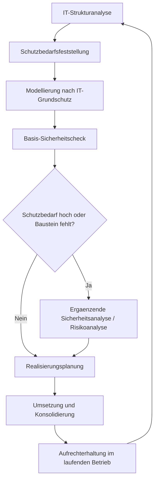

# 02 Grundschutz-Kompendium nach BSI
Dozent: Mathias Bücherl (M.Sc.)
Modul: Information Security Management (ISM)
Tags: #ITGrundschutz #BSI #ISO27001 #Informationssicherheit #ISMS #Risikoanalyse

Diese Vorlesung vermittelt die Architektur, Struktur und Methodik des modernisierten BSI IT-Grundschutz-Kompendiums im Vergleich zu den früheren Katalogen sowie der ISO/IEC 27001. Im Fokus stehen der Ablauf des IT-Grundschutz-Prozesses von der Strukturanalyse über die Schutzbedarfsfeststellung bis zum Basis-Sicherheitscheck sowie die Zertifizierungsstufen und die Risikoanalyse nach BSI-Standard 200-3.

### Kernprozess

### 1. Motivation und Grundidee des IT-Grundschutzes
- **Standardisierung von Abläufen:** Da Abläufe, Geschäftsprozesse und IT-Komponenten über Organisationen hinweg typische Gefährdungen und Schwachstellen teilen, bietet der Grundschutz ein wiederverwendbares, anpassbares und erweiterbares Sicherheitsgerüst.
- **Standard-Sicherheitsniveau:** Infrastrukturelle, organisatorische, personelle und technische Maßnahmen ermöglichen ein solides Standardniveau zum Schutz geschäftsrelevanter Informationen.
- **Aufwandsreduktion:** Statt Sicherheitskonzepte von Grund auf neu zu erfinden, werden zielgerichtete Bausteine ausgewählt und umgesetzt.
- **Modernisierung:** Reduktion des Umfangs von über 4000 Seiten (alte Kataloge) auf 816 Seiten (Kompendium) durch Trennung von Anforderungen und Umsetzungshinweisen.

### 2. Das BSI-Standardwerk und die neue Methodik
- **BSI-Standard 200-1:** Definiert die Grundlagen und Rahmenbedingungen für Managementsysteme für Informationssicherheit (ISMS).
- **BSI-Standard 200-2:** Beschreibt die IT-Grundschutz-Methodik und das Vorgehen zur Absicherung eines Informationsverbunds.
- **BSI-Standard 200-3:** Spezifiziert die Risikoanalyse auf Basis von IT-Grundschutz bei hohem/sehr hohem Schutzbedarf oder atypischen Szenarien.
- **BSI-Standard 100-4:** Behandelt das Notfallmanagement.
- **Verbindlichkeit von Anforderungen:** Abstufung in Muss-/Darf-nur-Anforderungen (verpflichtend), Soll-Anforderungen (Standard, begründete Abweichung möglich) und Kann-Anforderungen (fakultative Best Practices).
- **Funktionsorientiertes Schichtenmodell:** Trennung übergeordneter Prozess-Bausteine (ISMS, ORP, CON, OPS, DER) von technischen System-Bausteinen (IND, APP, SYS, NET, INF).

### 3. Vergleich der Sicherheitsstandards
| Kriterium | ISO/IEC 27001 nativ | Modernisierter IT-Grundschutz (BSI 200-x) | Klassischer IT-Grundschutz (BSI 100-x) |
| :--- | :--- | :--- | :--- |
| **Ausrichtung** | Prozessorientiert | Anforderungsorientiert | Maßnahmenorientiert |
| **Leitfrage** | Auf welche Weise? | Was ist abzusichern? | Wie ist es verbindlich umzusetzen? |
| **Freiheitsgrad** | Sehr hoch; Maßnahmen frei wählbar | Hoch; Anforderungen vorgegeben, Maßnahmen frei gestaltbar | Gering; starre und vorgegebene Maßnahmen |
| **Detailierungsgrad** | Eher abstrakt und generisch | Konkret ausgestaltet inklusive elementarer Gefährdungen | Sehr detailliert, teils überregulierend |
| **Aufwandstreiber** | Vollständige Risikoanalyse für alle Assets | Strukturanalyse und Modellierung | Umfassende Soll-Ist-Prüfung Tausender Katalogmaßnahmen |

### 4. Zertifizierung und Absicherungsstufen
- **Basis-Absicherung:** Grundlegende Erstabsicherung als Einstiegsstufe für Unternehmen zum Aufbau eines Mindestsicherheitsniveaus.
- **Standard-Absicherung:** Umfassende Absicherung des gesamten Informationsverbunds entsprechend normalem Schutzbedarf; bildet die Basis für ein ISO 27001-Zertifikat auf der Basis von IT-Grundschutz.
- **Kern-Absicherung:** Fokussierung der Sicherheitsressourcen auf besonders kritische Teilbereiche ("Kronjuwelen") mit meist hohem Schutzbedarf.
- **Audit-Testate:** Historisch unterteilt in Einstiegsstufe (A), Aufbaustufe (B) und Zertifikatsstufe (C); die neue Methodik setzt direkt auf die Standardabsicherung auf.

### 5. Detailphasen des IT-Grundschutz-Prozesses
- **IT-Strukturanalyse:** Vollständige Erfassung aller IT-Systeme, Netze, Anwendungen und Räume inklusive Komplexitätsreduktion durch Gruppenbildung gleichartiger Systeme.
- **Schutzbedarfsfeststellung:** Bewertung der Schutzbedarfe für Vertraulichkeit, Integrität und Verfügbarkeit in die Stufen normal/niedrig bis mittel, hoch und sehr hoch.
- **Maximumprinzip:** Ein übergeordnetes System erbt grundsätzlich den höchsten Schutzbedarf der darauf laufenden Anwendungen.
- **Kumulations- und Verteilungseffekte:** Modifikation des Schutzbedarfs nach oben (Kumulation durch viele Anwendungen auf einem System) oder unten (Redundanz und Verteilung).
- **Modellierung und Basis-Sicherheitscheck:** Zuordnung der passenden Bausteine zu Zielobjekten und Soll-Ist-Abgleich mittels Statuswerten (Ja, Teilweise, Nein, Entbehrlich).
- **Kreuzreferenztabellen:** Systematische Zuordnung zwischen Baustein-Anforderungen und elementaren Gefährdungen (z. B. G 0.18 bis G 0.46) zum Nachweis der Risikodeckung bezüglich CIA-Werten.
- **Realisierungsplanung:** Konsolidierung fehlender Maßnahmen, Aufwandsschätzung, Zuweisung von Budget/Verantwortlichkeiten und Festlegung von Umsetzungsfristen.

### Wichtigste Key Takeaways
- **Anforderungsorientierung statt Maßnahmenzwang:** Die modernisierte Grundschutz-Methodik definiert klar das „Was“ und lässt Organisationen den Umsetzungsspielraum beim „Wie“.
- **Konvergentes Schichtenmodell:** Die funktionale Unterteilung in Prozess- und Systembausteine schließt die methodische Lücke zwischen ISO 27001 und technischer Praxis.
- **Kombinierter Risikoansatz:** Standardbausteine decken den normalen Schutzbedarf effizient ab (ca. 80 %), während dedizierte Risikoanalysen gezielt für Härtefälle und Kernbereiche greifen (20 %).
- **Pragmatismus in der Umsetzung:** Sicherheitskonzepte erfordern eine schrittweise Implementierung im Betriebsalltag sowie kontinuierliche Wirksamkeitsprüfungen.