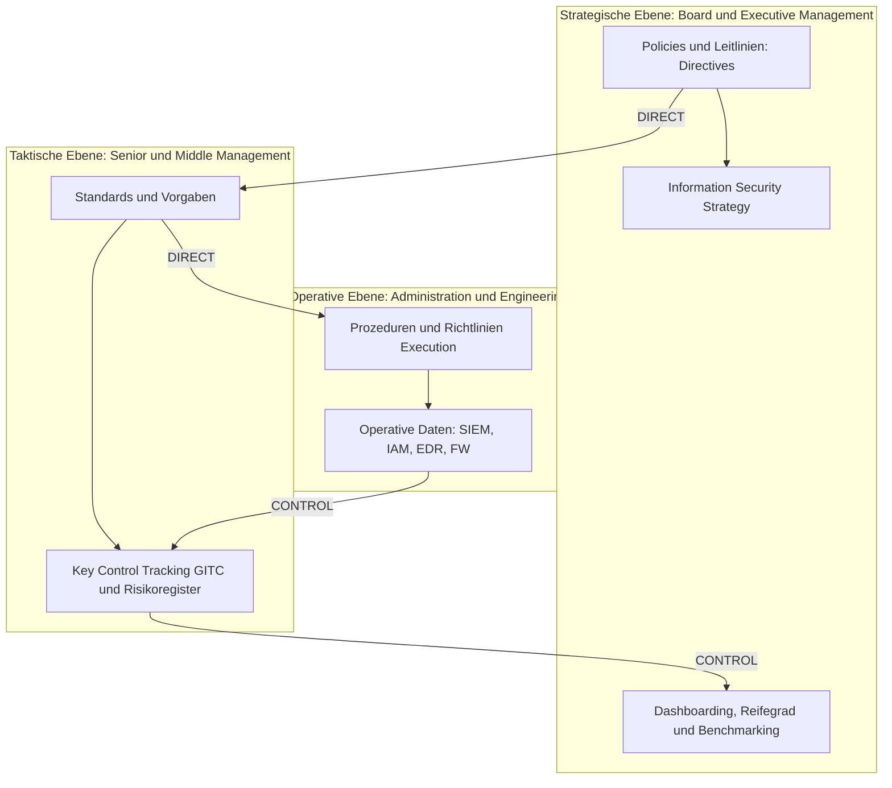

# The Role of the CISO - You Get The CISO You Deserve
Dozent: Prof. dr. mult. Yuri Bobbert
Modul: Digital Security Leadership / Information Security Management (Antwerp Management School)
Tags: #CISO #Cybersecurity #SecurityGovernance #RiskManagement #Leadership #eCF

Die Präsentation analysiert das Anforderungsprofil, die Governance-Strukturen und die strategische Bedeutung des Chief Information Security Officer (CISO) in modernen Organisationen. Neben der Einbettung in organisationale Steuerungszyklen (Direct-Execute-Control) werden Archetypen von Unternehmen und CISOs sowie die Weiterentwicklung von Rollenbildern bis hin zum Chief Information Security Orchestrator beleuchtet.

### Kernprozess der Security Governance

### 1. Governance-Struktur und Steuerungszyklus
- **Ebenen der Informationssicherheits-Governance:** Das Zusammenspiel zwischen Unternehmensführung, Management und IT folgt einem geschlossenen Regelkreis aus Ausrichtung (Direct) und Überwachung (Control).
  - **Strategische Ebene:** Festlegung von High-Level-Erwartungen, Sicherheitsstrategien und Unternehmensrichtlinien für die Gesamtorganisation.
  - **Taktische Ebene:** Definition quantifizierbarer Basisanforderungen, Standards und Steuerung von Risikoregistern.
  - **Operative Ebene:** Technische Prozeduren, Richtlinien und Ausführung operativer Sicherheitskontrollen.
- **Informationsfluss:** Ohne belastbare Messdaten und Reifegradmodelle kann das Executive Management keine Rechenschaft und Gesamtverantwortung übernehmen.

### 2. Dokumenttypen und Steuerungsebenen im Vergleich
| Dokumenttyp | Ebene | Primäres Ziel | Geltungsbereich |
| :--- | :--- | :--- | :--- |
| Corporate Policy | Strategisch | Festlegung übergeordneter Erwartungen und strategischer Leitlinien | Gesamte Organisation |
| Standard | Taktisch | Definition messbarer Mindestanforderungen und Sicherheitsbaselines | Schutzbereich / Protect Surface |
| Technical Procedure | Operativ | Konkrete Beschreibung der technischen Umsetzung und Ausführung | Schutzbereich / Protect Surface |

### 3. Organisations- und CISO-Archetypen
- **Organisatorische Lebenszyklen:** Basierend auf dem Wachstumsmodell nach Greiner durchlaufen Unternehmen Entwicklungsphasen (z. B. Kreativität, Führung, Delegation, Koordination, Kollaboration, Allianzen), die jeweils in spezifischen Krisen (z. B. Autonomie-, Kontroll- oder Bürokratiekrise) münden und veränderte Sicherheitsanforderungen erfordern.
- **CISO-Archetypen:** Das Rollenprofil muss zur Struktur und Reife des Unternehmens passen:
  - **(Corporate) Information Security Officer:** Klassische Ausrichtung auf unternehmensweite Richtlinien und Compliance.
  - **Chief IT Security Officer:** Stark fokussiert auf IT-Infrastruktur und technische Kontrollmechanismen.
  - **Chief Information Security Officer:** Umfassende Ausrichtung auf Informationsrisiken und Business-Ausrichtung.
  - **Chief Information Security Orchestrator:** Moderne Ausprägung, die Cybereconomics, Talentmanagement und Drittparteienrisiken in komplexen Ökosystemen vernetzt.
  - **Virtual CISO (vCISO):** Zunehmend genutztes Modell zur flexiblen Bereitstellung strategischer Security-Expertise.

### 4. Stakeholder-Landschaft und Kernkompetenzen
- **Strategische Schnittstellen:** Ein wirksamer CISO agiert im ständigen Dialog mit zentralen Stakeholdern:
  - **Vorstand / Board (CEO, CFO, COO):** Transparenz über Risiken, Mitigationen, Business Performance und Ressourcenallokation.
  - **Business Units (BISO, LISO, Security Champions):** Abstimmung von Sicherheitsinitiativen mit geschäftlichen Anforderungen zur Wertschöpfung.
  - **IT Operations & Enterprise Architecture:** Abstimmung von Umsetzbarkeit, Security-by-Design und Architekturstandards.
  - **Internal Audit, Legal & Compliance:** Gemeinsame Risikopriorisierung, regulatorische Konformität und Befundabarbeitung.
- **Erfolgsfaktoren:** Neben rein technischem Wissen erfordert die CISO-Rolle ein starkes Verständnis für Business Enablement, Kommunikationsfähigkeit, Krisenmanagement und Führungskompetenz.

### 5. Evolution der Sicherheitsrollen und Reifegrade
- **Neue Rollenbilder:** Durch Cloud, Automatisierung und KI entstehen spezialisierte Rollen wie AI Auditor, Virtual Identity Defender, Data Trash Engineer oder Security User Experience Designer.
- **Kompetenz-Frameworks:** Die Nutzung standardisierter Rahmenwerke wie des European e-Competence Frameworks (e-CF) unterstützt Organisationen bei der Definition von Anforderungsprofilen, Ausbildungspfaden und der Bewältigung des Fachkräftemangels.
- **Business Enablement:** Reife Informationssicherheit gilt als Wettbewerbsvorteil, der nachweislich zur Wertsteigerung von Unternehmen beiträgt und operative Resilienz sichert.

### Wichtigste Key Takeaways
- **CISO als Business Enabler:** Moderne Informationssicherheit ist keine reine IT-Verwaltung, sondern ein strategischer Werttreiber zur Risikominimierung und Unternehmensresilienz.
- **Passung zwischen Organisation und CISO-Typus:** Das Anforderungsprofil eines CISO muss sich an der Unternehmensreife, den Wachstumskrisen und dem Geschäftsmodell ausrichten ("You get the CISO you deserve").
- **Schlusselrolle des Orchestrators:** Künftige Leadership-Rollen fokussieren sich zunehmend auf Cybereconomics, Drittparteienrisiken in Plattform-Ökosystemen und das Binden von Spezialistentalenten.
- **Messbarkeit als Governance-Fundament:** Das Board kann Führungsverantwortung nur wahrnehmen, wenn ein durchgängiger Regelkreis von operativen Daten bis zu strategischen Metriken existiert.