# Product Security Lifecycle - Secure Development 2
Dozent: Alex Diekmann
Modul: SPREN (SPREN1) - Information Technology, HSLU
Tags: #ProductSecurity #DevSecOps #SDLC #CyberSecurity #AppSec #CRA #ThreatModeling

Diese Vorlesung behandelt den Entwicklungszyklus sicherer Produkte (Secure Product Development) als integralen Bestandteil des Product Cybersecurity Lifecycle. Schwerpunkte liegen auf der Klassifizierung von Produkten, sicherheitsrelevanten Anforderungen, Bedrohungsanalysen, Secure Sourcing, Implementierung, Testing sowie der Automatisierung mittels DevSecOps-Pipelines.

### Kernprozess

```mermaid
flowchart LR
    A[Security Planning und Classification] --> B[Security Requirements]
    B --> C[Threat Modelling und Risk Assessment]
    C --> D[Security Architecture und Design]
    D --> E[Secure Sourcing]
    E --> F[Secure Implementation]
    F --> G[Security Testing]
    G --> H[Security Documentation]
    H --> I[Security Certifications]
    I --> J[DevSecOps Pipeline]
```

### 1. Security Planning & Classification
- **Zielsetzung:** Bestimmung der Kritikalitaet des Produkts zur Identifikation relevanter gesetzlicher Vorgaben, Standards und des noetigen Sicherheitsniveaus inklusive Ressourcenplanung.
- **Wichtigste Artefakte:**
  - Klassifiziertes Produkt und Komponentenverzeichnis.
  - Cybersecurity Plan mit Aktivitaeten, Rollen, Zeitplaenen und Begruendungen fuer Tailoring.
- **Klassifizierungsmodelle:**
  - **EU Cyber Resilience Act (CRA):** Unterteilung in Default (Standardprodukte, ca. 90 % des Marktes, meist Selbsterklaerung), Important I (z. B. Passwort-Manager, Browser), Important II (z. B. Betriebssysteme, Firewalls, PLCs) und Critical (z. B. Hardware Security Modules, Smartcards, erfordert Drittpruefung/EUCC).
  - **IEC 62443 Security Levels (SL 0 - SL 4):** Abstufung vom Basisschutz gegen versehentliche Fehlbedienung (SL 1) bis hin zur Abwehr gezielter Angriffe hochmotivierter Angreifer mit umfangreichen Ressourcen (SL 4).
  - **ISO 21434 CAL (Cybersecurity Assurance Levels 1 - 4):** Skala zur Bestimmung der geforderten Pruef- und Verifikationstiefe sowie der organisatorischen Unabhaengigkeit von Sicherheitspruefern.

### 2. Security Requirements & Threat Assessment
- **Security Requirements:** Uebersetzung von internen, externen und regulatorischen Vorgaben in praezise, nachvollziehbare und SMART formulierte technische Anforderungen.
  - Schlechte Anforderungen bleiben vage (z. B. "Das System muss gehaertet sein"), waehrend gute Anforderungen konkrete technische Ports, Interfaces und Regelwerke festlegen.
- **Threat Analysis & Risk Assessment (TARA):** Systematische Erfassung von Bedrohungen und proaktive Behandlung von Risiken, sodass das verbleibende Restrisiko akzeptabel ist.
- **Architektur-Sichten:**
  - System Decomposition (Zerlegung in Komponenten und Module).
  - Deployment View (Netzwerk- und Betriebsumgebung).
  - Data Flow Diagrams (Datenfluesse und Schnittstellen zwischen Akteuren).

### 3. Secure Sourcing & Third-Party Management
- **Ziel:** Gewaehrleistung, dass fremdbeschaffte Hard- und Softwarekomponenten (COTS, Open Source, Cloud) definierten Sicherheitsstandards entsprechen.
- **Kriterien fuer COTS und Open Source:** Ueberpruefung bekannter Schwachstellen (CVEs), Patch-Zyklen, Responsible-Disclosure-Richtlinien, LTS-Support und Quellcode-Qualitaet.
- **Outsourced Development:** Definition von Sicherheitsvorgaben in Vertraegen, Tenant-Segregation, strikte Data Loss Prevention (DLP) und Vereinbarung von Audit-Rechten.

### 4. Secure Implementation & Neue Technologien
- **Secure Coding:** Einsatz von Coding-Standards, kontinuierlicher Code-Review und automatisierter Tool-Unterstuetzung.
- **Sicherheitswerkzeuge:**
  - **SAST (Static Application Security Testing):** Statische Quellcode-Pruefung auf Regeltreue und bekannte Anti-Patterns (z. B. SonarQube, Bandit).
  - **DAST (Dynamic Application Security Testing):** Dynamische Schwachstellenpruefung am laufenden System (z. B. OWASP ZAP, Burp).
  - **SCA (Software Composition Analysis):** Erkennung anfaelliger Bibliotheken und Dependencies (z. B. Snyk, Black Duck).
- **AI & Vibe Coding Risiken:**
  - Risiken durch halluzinierten oder vordefiniert unsicheren Code, Offenlegung von Unternehmensgeheimnissen (IP Leaks) und Lizenzverletzungen.
  - OWASP Top 10 for LLMs (u. a. Prompt Injection, Sensitive Information Disclosure, Supply Chain Vulnerabilities, Data Poisoning).

### 5. Security Testing, Traceability & Zertifizierung
- **Traceability:** Durchgaengige Rueckfuehrbarkeit von Produktanforderungen ueber technische Anforderungen und Testfaelle bis hin zu den Testresultaten.
- **Security Documentation:** Bereitstellung von Hardening-Guides, Benutzerhandbuechern fuer den sicheren Betrieb, Release Notes, Sicherheitskonzepten und einer vollstaendigen Software Bill of Materials (SBOM).
- **Zertifizierung:** Strukturierte Vorbereitung auf Konformitaetsbewertungen und Sicherheitszertifizierungen (z. B. CE-Kennzeichnung unter CRA, Common Criteria).

### 6. DevSecOps & Reifegradmodelle
- **Automatisierung in CI/CD:** Shift-Left-Integration von Security-Pruefungen (Linter, Unit Tests, SAST, SCA, Compiler Flags, Hardening, DAST und Freigabe-Gates) direkt in den Build- und Release-Prozess.
- **OWASP DSOMM (DevSecOps Maturity Model):** Reifegradmodell ueber vier Reifegrade (Maturity 1 bis 4) in Dimensionen wie Build and Deployment, Culture and Organization, Test and Verification sowie Monitoring/Logging.

### 7. Rollenverteilung im Sicherheitslebenszyklus
| Lifecycle-Phase | Responsible (R) | Accountable (A) | Supporting (S) | Consulted (C) |
| :--- | :--- | :--- | :--- | :--- |
| Planning & Classification | Project Lead | Product Owner | Product Security | Architect, Scrum Master |
| Security Requirements | Requirements Manager | Product Owner | Project Lead, Product Security | Architect, Developer |
| Threat Analysis & Risk | Product Security | Product Owner | Project Lead, Architect | Developer |
| Security Architecture & Design | Architect | Product Owner | Developer, Product Security | Project Manager |
| Secure Sourcing | Project Lead | Product Owner | Sourcing, Product Security | Architect |
| Secure Implementation | Developer | Product Owner | Architect, Project Lead | Product Security |
| Security Testing | Test Manager | Product Owner | Product Security, Developer | Requirements Manager, Architect |
| DevSecOps Pipeline | Developer | Product Owner | Architect, Build Master, Test Manager | Product Security |

### Wichtigste Key Takeaways
- **Security by Design statt Nachruestung:** Sicherheit muss von der Fruehphase (Planning & Classification) ueber Architektur bis zum Testen fest verankert sein; spaeteres "Nachruesten" fuehrt zu hohen Kosten und Zertifizierungsrisiken.
- **Regulatorischer Druck als Treiber:** Gesetze wie der EU Cyber Resilience Act (CRA) und Standards wie IEC 62443 und ISO 21434 machen Sicherheitskonzepte und Drittpruefungen verbindlich.
- **Lueckenlose Traceability:** Sicherheitsanforderungen muessen ueber Architekturentscheidungen und Massnahmen bis zu konkreten Testfaellen und Testberichten auditierbar nachverfolgbar sein.
- **Automatisierung durch DevSecOps:** Automatisierte Checks (SAST, SCA, DAST) innerhalb der CI/CD-Pipeline beschleunigen Releases und verhindern, dass Schwachstellen unentdeckt in Produktion gelangen.
- **Kontrollierter Einsatz von KI-Tools:** KI-gestuetzte Entwicklung erfordert strikte Verifikation, Monitoring gegen Secret Leaks und klassische Sicherheitsueberpruefungen gemaess OWASP LLM-Richtlinien.