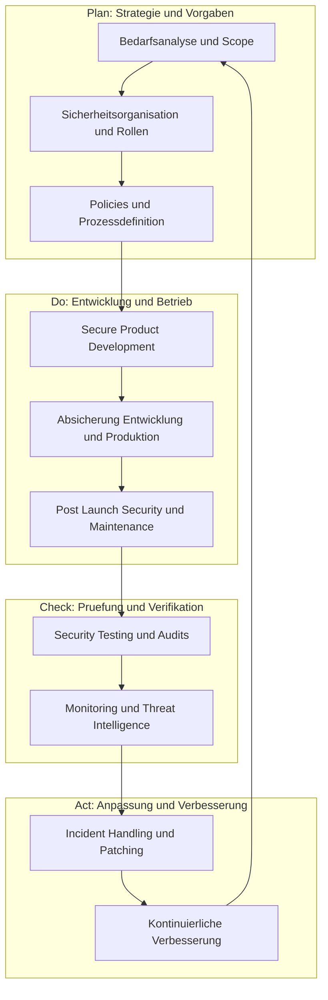

# Product Security Lifecycle - Secure Development 3
Dozent: Alex Diekmann
Modul: SPREN (Information Technology)
Tags: #ProductSecurity #CSMS #SecureDevelopment #DevSecOps #M_and_A #Governance

Diese Vorlesung vermittelt die Grundlagen zur Etablierung eines Cybersecurity Management Systems (CSMS) über den gesamten Produktlebenszyklus hinweg. Neben Governance-Strukturen und der Absicherung von Entwicklungs- sowie Produktionsumgebungen wird detailliert betrachtet, wie Produkt-Sicherheitsrisiken bei organisatorischen Veränderungen wie Fusionen, Übernahmen und Ausgliederungen systematisch gesteuert werden.

### Kernprozess

### 1. Cybersecurity Management System (CSMS) & Governance
- **Product Cyber Security vs. Information Security:** Fokussiert primär auf den Schutz des Endprodukts und dessen Betriebslebenszyklus im Feld, wohingegen traditionelle Informationssicherheit Unternehmenswerte und interne IT-Systeme schützt.
- **Treiber und Standards:** Externe Regulatorien wie UN R155, FDA Cybersecurity Guidelines, IEC 62443, ISO 21434 sowie ISO 15408 bilden verbindliche Rahmenwerke für Produkthersteller.
- **PDCA-Zyklus in der Governance:** Systematische Verankerung durch Planen (Strategie, Rollen, Schulung), Umsetzen (Risikomanagement, SDL, Lieferkettensicherheit), Prüfen (Audits, Tests, Kennzahlen) und Handeln (Schwachstellen- und Vorfallmanagement).
- **Entwicklung von Policies:** Richtlinien müssen kurz gehalten werden, Kernverantwortlichkeiten hervorheben und durch zielgruppenspezifische Vorlagen und Trainings gestützt werden, statt bloße Textwüsten zu erzeugen.
- **Entwicklung von Standard Operating Procedures (SOP):** Prozesse definieren klare Auslöser, Inputs, Outputs, Werkzeuge und Meilensteine unter strikter Anwendung des RASCI-Modells.

### 2. Absicherung von Entwicklungs- und Produktionsumgebungen
- **Schutzziel:** Absicherung von Daten, Infrastrukturen, Test- und Fertigungsumgebungen gegen Manipulation, Know-how-Abfluss und Supply-Chain-Angriffe.
- **Bedrohungsanalyse für R&D:** Identifikation kritischer Werte wie Quellcode, Firmware-Images, Entwicklungs- und Signierschlüssel sowie Testdaten.
- **Gefahrenquellen im Umfeld:**
  - Externe Entwicklungspartner und Schnittstellen zu Cloud-Diensten.
  - Physischer Zugriff auf Fertigungsstätten, Mustergeräte und Serverräume.
  - Menschliche Faktoren wie Fehlkonfigurationen und unzureichende Rechtestrukturen.
- **Vorgehensweise:** Iteration über Threat Modeling, Risikobewertung, Implementierung gezielter Mitigationsmassnahmen und kontinuierliches Betriebsmonitoring.

### 3. Sicherheitskultur, Awareness & Training
- **Verankerung der Sicherheitskultur:** Das Ziel ist es, den sicheren Entwicklungsweg zum Standardansatz (Default Choice) für Entwickler und Ingenieure zu machen.
- **Argumentationsdreiklang (Facts, Figures, Feelings):**
  - **Facts:** Regulatorische Vorgaben, konkrete Bedrohungsanalysen und Lehren aus vergangenen Sicherheitsvorfällen transparent machen.
  - **Figures:** Finanzielle Auswirkungen, Kennzahlen und Aufwandsschätzungen fundiert beziffern.
  - **Feelings:** Management-Commitment zeigen, Mehraufwände anerkennen, eine No-Blame-Kultur leben und gemeinsame Erfolge feiern.
- **Schulungskonzeption:** Bedarfsgerechte Module (Secure Coding, Policy-Schulungen, Incident-Response-Übungen) nach der Kipling-Methode aufbauen (Why, What, Who, How, When, Where).

### 4. Rollen und Verantwortlichkeiten in der Security Governance
| Rolle | Funktion & Verantwortung im RASCI-Gefüge |
| :--- | :--- |
| Security Management | **Responsible (R):** Führt Sicherheitsaktivitäten operativ aus, erstellt Policies und steuert Prozesse. |
| Company / Senior Management | **Accountable (A):** Trägt die Gesamtverantwortung, stellt Budgets bereit und zeichnet Governance-Entscheide ab. |
| IT & Site Management | **Supporting (S):** Unterstützt bei der technischen Umsetzung von Infrastruktur- und physischen Sicherheitskontrollen. |
| Quality & Sourcing | **Consulted (C):** Wird bei Beschaffungsprozessen, Lieferantenbewertungen und Qualitätsaudits beratend eingebunden. |
| All Staff / Dev & Prod | **Informed (I):** Wird über Richtlinien informiert, geschult und setzt Vorgaben im Tagesgeschäft um. |

### 5. Produkt-Cybersecurity bei organisatorischen Veränderungen (M&A)
- **M&A-Typen:**
  - **Merger:** Fusion zweier Organisationen auf Augenhöhe.
  - **Acquisition:** Kauf eines Unternehmens zur Markterweiterung, IP-Akquisition oder Kapazitätserweiterung.
  - **Divest:** Verkauf von Unternehmensteilen zur strategischen Fokussierung oder Liquiditätsgewinnung.
- **Phasenbezogene Produkt-Sicherheitsziele:**
  - **Selection Phase:** Formulierung von Sicherheitsausschlusskriterien und Identifikation geeigneter Übernahmekandidaten.
  - **Due Diligence & Closing:** Umfassende Analyse technischer Schulden, Schwachstellen und Schnittstellen; Bereitstellung der Entscheidungsgrundlage (Go / No-Go).
  - **Integration Phase:** Schrittweise Zusammenführung von Teams, Sicherheitsarchitekturen, Quellcode-Repositories und Toolchains.
  - **Separation Phase:** Saubere Trennung von IT-Systemen, Berechtigungen und Datenbeständen zur Wahrung der Business Continuity.

### Wichtigste Key Takeaways
- **Sicherheit ist ein Enabler:** Produkt-Cybersecurity schützt Geschäftsmodelle, verhindert ungeplante Kosten und sichert den Marktzugang unter strengen regulatorischen Auflagen.
- **Kultur schlägt Vorschriften:** Richtlinien greifen nur dann nachhaltig, wenn Entwickler den Mehrwert verstehen und sichere Praktiken durch Training und No-Blame-Kultur zur Routine werden.
- **Produktionsumgebungen sind hochgradig exponiert:** Entwicklungswerkzeuge, Signierschlüssel und Code-Pipelines sind primäre Angriffsvektoren und bedürfen derselben Härtung wie Endprodukte.
- **Cyber-Risiken gefährden M&A-Transaktionen:** Unentdeckte Sicherheitslücken oder Architekturmängel in Zukäufen mindern den Unternehmenswert drastisch und erfordern eine frühzeitige technische Due Diligence.