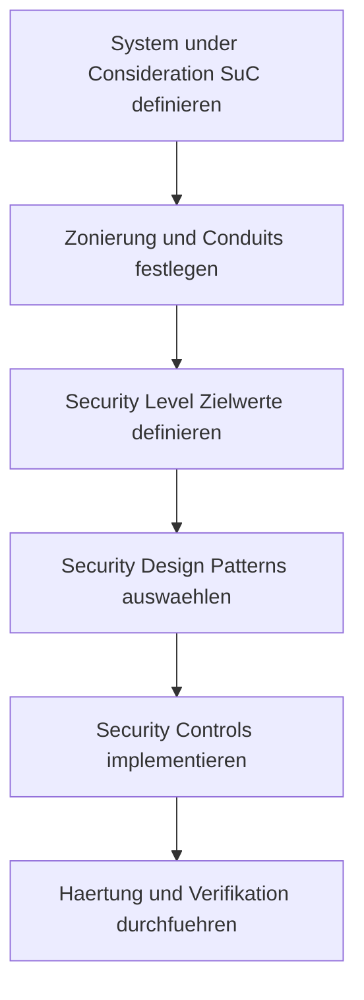

# Architecture and Design in a Cybersecurity Product Context
Dozent: Chris Ditze-Stephan
Modul: SPREN1 - Architecture and Design
Tags: #Cybersecurity #SecurityArchitecture #IEC62443 #ProductSecurity #DefenseInDepth #SecurityPatterns

Diese Vorlesung behandelt die Konzeption und Umsetzung robuster Sicherheitsarchitekturen im Kontext von dedizierten Cyber-Security-Produkten, industriellen Steuerungssystemen (IACS) sowie IoT-Umgebungen. Der Fokus liegt auf der praktischen Anwendung von Sicherheitsstandards wie der IEC 62443, der Segmentierung in Sicherheitszonen und Conduits sowie der Definition konkreter Design Patterns und Security Controls.

### Kernprozess

### 1. Grundlagen der Sicherheitsarchitektur
- **Architektur-Begriff:** Analog zur Bauarchitektur beschreibt die IT- und Produktsicherheitsarchitektur den grundlegenden Bauplan eines Systems mit seinen Komponenten, Grenzen und Schutzmechanismen.
- **Produktsicherheits-Attribute:** Unterscheidet sich maßgeblich von klassischer Office-IT-Infrastruktur und ähnelt betrieblicher IT (OT) bzw. IoT in kontrollierten Umgebungen.
- **Leitprinzipien:**
  - Vertrauenswürdige Kommunikation erfordert stets eine vertrauenswürdige Umgebung.
  - Komplexität verringert Sicherheit (Complexity decreased security).
  - First, do no harm: Funktionale Integrität und Sicherheit dürfen nicht beeinträchtigt werden.

### 2. Normativer Rahmen und Relevante Standards
- **IEC 62443:** Zentraler Standard für die Sicherheit industrieller Automatisierungs- und Steuerungssysteme.
  - **IEC 62443-3-3:** Sicherheitsanforderungen an Systeme und Sicherheitsstufen (Security Levels).
  - **IEC 62443-4-1:** Anforderungen an den sicheren Produktentwicklungsprozess (SDLC).
  - **IEC 62443-4-2:** Technische Sicherheitsanforderungen an Komponenten (Foundational Requirements).
- **ISO/IEC 27033:** Leitfaden und Richtlinien für Netzwerksicherheitsarchitekturen und Bedrohungsanalysen.
- **ISO/IEC 27701:** Erweiterung für Datenschutz- und Privatsphäre-Management.

### 3. Zonen- und Conduit-Modell (IEC 62443)
- **System under Consideration (SuC):** Das zu analysierende Gesamtsystem, bestehend aus allen relevanten Komponenten, Interfaces, Servern und Cloud-Diensten.
- **Security Zone:** Logische oder physische Gruppierung von Assets mit identischen Sicherheitsanforderungen und einheitlichem Ziel-Sicherheitsniveau.
- **Conduit:** Ein Kommunikationskanal, der zwei oder mehr Zonen verbindet und Sicherheitsfunktionen zur kontrollierten Übertragung bereitstellt. Jegliche zonenübergreifende Kommunikation muss zwingend über Conduits erfolgen.

### 4. Sicherheitsstufen und Foundational Requirements
- **Security Level (SL):** Ein Maß für die Widerstandsfähigkeit gegenüber Angriffen:
  - **SL 1:** Schutz gegen zufällige oder versehentliche Fehler.
  - **SL 2:** Schutz gegen vorsätzliche Angriffe mit einfachen Mitteln und geringen Ressourcen.
  - **SL 3:** Schutz gegen vorsätzliche Angriffe mit spezifischen Kenntnissen und moderaten Ressourcen.
  - **SL 4:** Schutz gegen hochentwickelte Angriffe durch staatliche Akteure mit umfangreichen Ressourcen.
- **SL-Vektor:** Spezifikation von Vektoren für Zielvorgaben (SL-T), erreichte Stufen (SL-A) und Fähigkeiten (SL-C) über sieben Basisanforderungen (Foundational Requirements, FR):
  - **IAC (FR 1):** Identification and Authentication Control
  - **UC (FR 2):** Use Control (Autorisierung)
  - **SI (FR 3):** System Integrity
  - **DC (FR 4):** Data Confidentiality (Verschlüsselung)
  - **RDF (FR 5):** Restricted Data Flow (Segmentierung & Firewalls)
  - **TRE (FR 6):** Timely Response to Events (Incident Handling)
  - **RA (FR 7):** Resource Availability (Verfügbarkeit & DoS-Schutz)

### 5. Übersicht: Sicherheitsmaßnahmen nach Typen
| Ebene / Domäne | Präventiv (Preventive) | Detektiv (Detective) | Retrospektiv (Retrospective) |
| :--- | :--- | :--- | :--- |
| **Application** | Testing, Training, Firewall, Whitelisting, Access Control | Vulnerability Monitoring | Incident Response, Digital Forensics, Remediation |
| **Network** | IPS, Threat Intelligence, VPN, Secure Web Gateways | SIEM, Traffic Analysis, Intrusion Detection (IDS) | Remediation, Incident Response, Forensik |
| **Endpoint** | Härtung, Malware Protection, Mobile Device Management | IoC Monitoring, Host IDS, Log-Analysen | Remediation, Forensik, Wiederherstellung |
| **Cloud** | Toolchain Isolation, Verschlüsselung, Risikomanagement | Anomalie-Erkennung, Cloud Intrusion Monitoring | Incident Response, Forensik |

### 6. Design Patterns und Technische Basissysteme
- **Cybersecurity Design Patterns:** Standardisierte, wiederverwendbare Entwurfsmuster zur Lösung wiederkehrender Sicherheitsprobleme in Entwicklung und Betrieb.
- **Public Key Infrastructure (PKI):** Authentifizierung und Identitätsprüfung über Zertifikate (X.509v3) und asymmetrische Verschlüsselungsverfahren.
- **Firewalls & Netzwerktrennung:** Segmentierung über Paketfilter, Stateful Inspection, Proxy, Next-Gen Firewalls oder Cloud-Firewalls (WAF).
- **Intrusion Detection & Prevention (IDS/IPS):** Netzbasiert (NIDS/NIPS) oder hostbasiert (HIDS/HIPS) zur Erkennung bzw. aktiven Unterbindung schädlicher Aktivitäten.
- **Applikationskontrolle:** Bevorzugung von Whitelisting (Application Control via Hash/Signatur) gegenüber fehleranfälligem Blacklisting.
- **Systemhärtung:** Minimierung der Angriffsfläche durch standardisierte Vorgaben wie CIS-Benchmarks oder STIGs (Security Technical Implementation Guides).

### Wichtigste Key Takeaways
- **Ganzheitliche Integration:** Security-Architektur ist keine isolierte Disziplin, sondern muss direkt in die Systemarchitektur und den Entwicklungslebenszyklus (SDLC) eingebettet werden.
- **Zonierung ist Grundvoraussetzung:** Die strukturierte Unterteilung in Zonen und kontrollierte Conduits nach IEC 62443 ermöglicht eine gezielte Risikoreduktion und Beherrschbarkeit.
- **Härtung vor Abwehr:** Die systematische Reduzierung der Angriffsfläche durch Konfiguration und Least Privilege ist wirkungsvoller als rein reaktive Schutzmaßnahmen.
- **Defense in Depth statt Einzellösungen:** Ein vollständiges Sicherheitskonzept erfordert unabhängige Schutzmechanismen auf Netzwerk-, System-, Applikations- und Datenebene.