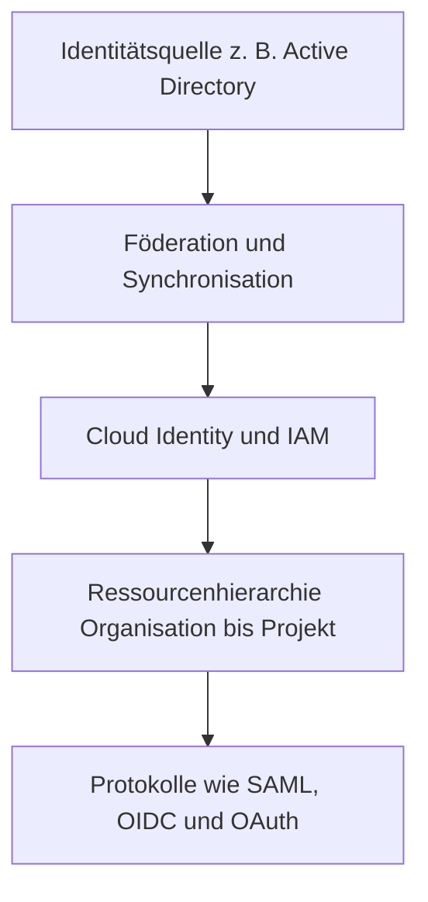

# Lecture 2: Identity in the Cloud
Dozent: Nicht angegeben
Modul: CloudSec
Tags: #CloudSecurity #IAM #Federation #OAuth #OpenIDConnect #SAML

Diese Präsentation behandelt die Grundlagen und fortgeschrittenen Konzepte des Identity and Access Managements (IAM) in Cloud-Umgebungen. Im Fokus stehen Cloud-IAM-Strukturen, Verzeichnissynchronisation, föderierte Identitäten sowie die gängigen Protokolle SAML, OAuth 2.0 und OpenID Connect zur Authentifizierung und Autorisierung.

### Kernprozess

### 1. Cloud IAM und Ressourcenhierarchie
- **Identitätsfrage:** Beantwortet im Cloud-Kontext die zentrale Frage, wer (Who) welche Aktionen (Can do What) auf welchen Ressourcen (On Which Resource) ausführen darf[cite: 43].
- **Ressourcenhierarchie:** Die Struktur gliedert sich in Organisation, Ordner, Projekte und darin enthaltene Ressourcen, wobei Berechtigungen top-down vererbt werden[cite: 47].
- **Service Accounts:** Spezielle Nicht-Mensch-Konten (Identitäten für Apps), die von Workloads oder Instanzen genutzt werden, um nach dem Prinzip der minimalen Rechte (Least Privilege) auf APIs zuzugreifen[cite: 54, 55, 56].

### 2. Akteure und Autorisierungsmodelle im Überblick
| Modell / Konzept | Beschreibung und Funktion |
| :--- | :--- |
| **RBAC (Role-Based Access Control)** | Benutzer werden Rollen zugewiesen, welche definieren, welche Berechtigungen für bestimmte Aufgaben vergeben sind[cite: 41]. |
| **ABAC (Attribute-Based Access Control)** | Zugriffskontrolle basierend auf dynamischen Attributen von Benutzern, Ressourcen und Umgebung[cite: 42]. |
| **Cloud Identity** | Integrierter Identitätsdienst zur zentralen Verwaltung von Benutzern, Gruppen und Single Sign-On[cite: 53, 69]. |
| **GCDS (Google Cloud Directory Sync)** | Tool zur unidirektionalen Synchronisation von Benutzern und Gruppen aus Active Directory in die Cloud[cite: 58]. |

### 3. Föderation und Protokolle (SAML, OAuth, OIDC)
- **SAML 2.0:** Ein XML-basierter Standard für Enterprise-Single-Sign-On, der die Authentifizierung von Unternehmensnutzern an externe Identitätsanbieter delegiert[cite: 87, 89].
- **OAuth 2.0:** Ein reines Autorisierungsframework zur Vergabe von zeitlich begrenzten Zugriffstokens (Access Tokens) für APIs, ohne Anmeldeinformationen offenzulegen[cite: 91, 92].
- **OpenID Connect (OIDC):** Eine moderne Identitätsschicht auf Basis von OAuth 2.0, die zusätzlich standardisierte Authentifizierung und JWT-basierte Identitäts-Token liefert[cite: 94, 95].

### Wichtigste Key Takeaways
- **Trennung von AuthN und AuthZ:** Authentifizierung (Wer bist du?) und Autorisierung (Was darfst du?) müssen klar getrennt und über passende Protokolle geregelt werden[cite: 104].
- **Principle of Least Privilege:** Benutzer und Servicekonten sollten stets nur die minimal notwendigen Berechtigungen erhalten, um die Angriffsfläche zu minimieren[cite: 47, 56].
- **Protokoll-Koexistenz:** SAML deckt den Enterprise-Bereich ab, OIDC steuert moderne Logins (Web/Mobile) und OAuth 2.0 sichert Microservices und APIs ab[cite: 99, 103].
- **Zukunftssicherheit durch Modernisierung:** Der Einsatz von Mechanismen wie PKCE, Passkeys und Continuous Access Evaluation (CAEP) erhöht die Resistenz gegen Phishing und Angriffe massiv[cite: 101, 102].