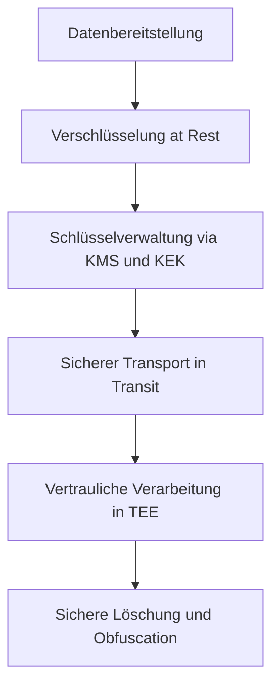

# Lecture 3: Encryption in the Cloud
Dozent: Nicht angegeben
Modul: CloudSec
Tags: #CloudSecurity #Encryption #KMS #ConfidentialComputing #DataProtection

Diese Präsentation beleuchtet umfassende Sicherheitsmechanismen und Schutzmaßnahmen in Cloud-Umgebungen. Der Fokus liegt dabei auf der Verschlüsselung von Daten in den drei Zuständen Ruhezustand (at rest), Übertragung (in transit) und Verarbeitung (while processing) sowie auf Schlüsselmanagement, Secrets Management und Dateneinwilligung bzw. -löschung.

### Kernprozess

### 1. Encryption at Rest & Key Management
- **Encryption at Rest:** Beschreibt den Schutz aller ruhenden Inhalte im Cloud-Speicher, bei dem Daten typischerweise in Chunks unterteilt und mit individuellen DEKs verschlüsselt werden[cite: 3].
- **DEK und KEK:** Data Encryption Keys (DEKs) verschlüsseln die eigentlichen Daten und werden ihrerseits durch Key Encryption Keys (KEKs) in zentralen KMS-Diensten geschützt[cite: 3, 11].
- **Key Hierarchy:** Das mehrstufige Schlüsselmodell reicht von der Speicher-Ebene über Cloud KMS bis hin zu Hardware-Sicherheitsmodulen (HSMs) und physischen Tresoren als Root of Trust[cite: 12].

### 2. Akteure und Speicherebenen im Überblick
| Komponente / Konzept | Funktion & Beschreibung |
| :--- | :--- |
| **Standard Storage** | Geeignet für hochfrequentierte "hot" Daten wie Webseiten oder Streaming-Inhalte[cite: 4]. |
| **Archive Storage** | Kosteneffizienteste Aufbewahrung für Daten mit langer Mindestspeicherungsdauer (z. B. 365 Tage)[cite: 4]. |
| **Cloud KMS** | Verwaltet KEKs zentral, erzwingt automatische Rotation und schützt vor unautorisiertem Export[cite: 11]. |
| **HSM** | Hardware-basiertes Sicherheitsmodul zur sicheren Schlüsselerzeugung und -speicherung[cite: 14]. |

### 3. Encryption in Transit & while Processing
- **Encryption in Transit:** Sichert die Datenübertragung über Netzwerke hinweg durch Protokolle wie TLS an Frontends sowie VPN, Direct Peering oder dedizierte Interconnects für Hybrid-Clouds[cite: 22].
- **Confidential Computing:** Schützt Daten während der Verarbeitung (in-use) durch isolierte Ausführungsumgebungen auf Hardwarebasis (Trusted Execution Environments, TEEs)[cite: 29].
- **Confidential VMs:** Nutzen speicherverschlüsselte Instanzen (z. B. via AMD SEV oder Intel SGX), um Workloads vor Zugriffen des Hypervisors oder Administrators abzuschirmen[cite: 26, 27].

### 4. Lifecycle, Secrets & Data Deletion
- **Secrets Manager:** Zentraler Single Point of Truth für die sichere Verwaltung und Audifizierung von API-Schlüsseln, Passwörtern und Zertifikaten[cite: 34].
- **Data Deletion:** Der Löschprozess erstreckt sich über mehrere Stufen (von aktiven Systemen über Soft-Deletion und Backup-Ablauf bis zu 180 Tagen), wobei physische Datenträger am Ende überschrieben oder mechanisch zerstört werden[cite: 32].
- **Data Obfuscation:** Techniken wie Anonymisierung, Pseudonymisierung und Tokenisierung erlauben die datenschutzkonforme Nutzung von sensiblen Informationen ohne direkten Personenbezug[cite: 36].

### Wichtigste Key Takeaways
- **Verschlüsselung über alle Phasen:** Daten müssen im Ruhezustand, während des Transports und bei der Verarbeitung durchgängig geschützt sein[cite: 2].
- **Hardware-basierte Isolation:** Confidential Computing schützt aktive Rechenprozesse und den Hauptspeicher effektiv vor externen und Insider-Bedrohungen[cite: 28, 29].
- **Schlüsselkontrolle ist zentral:** Das Verwenden von Modellen wie BYOK (Bring Your Own Key) oder Cloud EKM gibt Kunden die maximale Kontrolle über ihre kryptografischen Schlüssel[cite: 17, 19].
- **Nachvollziehbare Datenlöschung:** Ein strukturierter Lösch- und Entsorgungsprozess stellt sicher, dass Altdaten und ausgemusterte Speichermedien vollständig vernichtet werden[cite: 32].