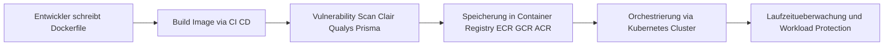

# Lecture 4: Container Security
Dozent: Nicht explizit genannt
Modul: CloudSec HS2026 (Lucerne University of Applied Sciences and Arts / HSLU)
Tags: #ContainerSecurity #CloudSecurity #Docker #Kubernetes #CWS #DevSecOps

Diese Vorlesung vermittelt die Grundlagen der Containerisierung sowie deren Abgrenzung zu virtuellen Maschinen und beleuchtet die Kernaspekte moderner Container-Orchestrierung mittels Kubernetes. Besonderer Fokus liegt auf der Sicherheitsarchitektur, dem Modell der geteilten Verantwortung (Shared Responsibility), Schwachstellenscans im Rahmen der Supply Chain Security sowie Cloud Workload Security Lösungen wie CNAPP.

### Kernprozess

### 1. Grundlagen der Containerisierung
- **Container-Konzept:** Eine logische Abstraktions- und Paketierungsschicht, welche die eigentliche Anwendung samt Abhängigkeiten von der darunterliegenden Ausführungsumgebung trennt.
  - **Entkopplung:** Entwickler fokussieren sich auf Geschäftslogik und Bibliotheken, während IT-Operations für Bereitstellung und Infrastruktur zuständig sind.
  - **Konsistenz:** Ermöglicht identisches Verhalten über Entwicklungs-, Test- und Produktionssysteme hinweg ("Run Anywhere").
- **OS-Level-Virtualisierung:** Container teilen sich den Kernel des Host-Betriebssystems anstatt wie virtuelle Maschinen Hardware über einen Hypervisor zu virtualisieren.
  - **Ressourceneffizienz:** Geringer Speicher-Overhead, sehr kleine Image-Größen und sekundenschnelle Startzeiten im Vergleich zu vollwertigen Gast-Betriebssystemen.
  - **Sandboxing:** Isolation von CPU, RAM, Speicher und Netzwerk über Kernel-Mechanismen, wodurch Ressourcenkonflikte vermieden werden.
- **Docker-Architektur:** De-facto-Standard zum Erstellen, Teilen und Ausführen containerisierter Anwendungen.
  - **Dockerfile:** Schritt-für-Schritt-Bauanleitung für ein Image (z. B. FROM, WORKDIR, COPY, RUN, EXPOSE, CMD).
  - **Docker Image:** Unveränderlicher Bauplan mit privatem Dateisystem, Runtimes und Bibliotheken.
  - **Container:** Isolierter, laufender Prozess, der aus einem Image instanziiert wurde.

### 2. Vergleich: Virtuelle Maschinen vs. Container
| Merkmal | Virtuelle Maschine (VM) | Container |
| :--- | :--- | :--- |
| **Virtualisierungsebene** | Hardware-Ebene (Hypervisor) | Betriebssystem-Ebene (Host-OS-Kernel) |
| **Betriebssystem** | Vollständiges Gast-OS pro VM | Gemeinsame Kernel-Nutzung |
| **Ressourcen-Overhead** | Hoch (benötigt viel RAM/Disk) | Minimal (Start als diskreter Prozess) |
| **Startzeit** | Minuten | Millisekunden bis Sekunden |
| **Isolationsgrad** | Sehr stark (Hardware-Trennung) | Prozess- und Namespace-Isolation |

### 3. Container-Orchestrierung mit Kubernetes
- **Kubernetes (k8s):** Open-Source-Plattform zur automatisierten Bereitstellung, Skalierung und Verwaltung containerisierter Anwendungen, basierend auf Googles internem System Borg.
  - **Namensherkunft:** Griechisch für Steuermann oder Lotse.
  - **Funktionen:** Rollouts, Rollbacks, Self-Healing über automatische Health-Checks sowie dynamische Lastskalierung.
- **Kernkomponenten:**
  - **Pod:** Kleinste operationelle Ausführungseinheit in Kubernetes, umfasst einen oder mehrere eng gekoppelte Container.
  - **Node:** Physische oder virtuelle Arbeitsmaschine, die Pods ausführt und über das Host-OS verfügt.
  - **Master / Control Plane:** Steuereinheit des Clusters für Scheduling, API-Endpunkte und Ereignisverwaltung.
  - **etcd:** Konsistenter, hochverfügbarer Key-Value-Store zur Speicherung des Clusterzustands.
- **Vergleichbare Technologien:**
  - **Docker Swarm:** In Docker integrierte, leichtgewichtige Orchestrierungslösung für weniger komplexe Architekturen.
  - **Red Hat OpenShift:** Enterprise-Kubernetes-Plattform mit integrierten CI/CD-Pipelines und Entwickler-Tools, jedoch primär an Red Hat Linux-Distributionen gebunden.

### 4. Cloud-Dienste und Shared Responsibility
- **Cloud-Container-Ökosysteme:** Führende Provider bieten abgestufte Services von Managed Infrastructure (IaaS) über Kubernetes (CaaS/PaaS) bis hin zu Serverless-Container-Laufzeiten (z. B. AWS ECS/EKS/Fargate, GCP GKE/Cloud Run, Azure AKS).
- **Verantwortungsaufteilung bei Kubernetes PaaS:**
  - **Verantwortung des Cloud-Providers:** Physische Infrastruktur, Rechenzentren, Hypervisor, Hardened OS Kernel, Master-VMs / Control Plane (API-Server, etcd) sowie Plattform-Integrationen (KMS, IAM).
  - **Verantwortung des Kunden:** Konfiguration und Updates der Worker Nodes, Pod-Definitionen, Dockerfiles, Anwendungsquellcode, Daten, Workload-Images, IAM- und RBAC-Richtlinien sowie Netzwerk-Policies.

### 5. Container- und Workload-Sicherheit
- **Supply Chain Security:** Container verbessern das Sicherheitsniveau durch Prinzipien wie Unveränderlichkeit (Immutability). Jede Änderung an einem Container zur Laufzeit gilt als Anomalie. Schnelle Redeployments ermöglichen kontinuierliches Patchen.
- **Vulnerability Scanning:** Automatisiertes Überprüfen von Container-Images auf bekannte Sicherheitslücken (CVEs) in Registries vor und während der Bereitstellung (z. B. AWS ECR Scanning via Clair, Google Container Analysis, Azure/Qualys-Integration).
- **Cloud Workload Security (CWS) & CNAPP:** Umfassender Schutz von Workloads über den gesamten Lifecycle durch Plattformen wie Prisma Cloud oder McAfee CWS.
  - **Anforderungen:** Native Laufzeitabsicherung des Host- und Gast-OS (File/Memory Integrity), templatisiertes Konfigurations- und Richtlinien-Management via APIs sowie kontinuierliches Monitoring von Inter-Container-Netzwerkverkehr.
- **OWASP-Relevanz:**
  - **OWASP Top 10:** Übergreifende Web-Sicherheitsrisiken wie Broken Access Control, Cryptographic Failures und Injection.
  - **OWASP Cloud-Native Top 10:** Spezifische Bedrohungen moderner Architekturen, darunter unsichere Cloud-/Container-Konfigurationen, CI/CD-Pipeline-Schwachstellen, unzureichende Secret-Verwaltung und fehlerhafte Netzwerksegmentierung.

### Wichtigste Key Takeaways
- **OS-Virtualisierung als Effizienztreiber:** Container teilen sich den Kernel des Host-Betriebssystems und bieten dadurch maximale Portabilität und Ressourceneffizienz bei geringerem Overhead als VMs.
- **Orchestrierung löst Betriebskomplexität:** Kubernetes abstrahiert Infrastrukturen zu Clustern und automatisiert Skalierung, Ausfallsicherheit und Rollouts von containerisierten Microservices.
- **Shared Responsibility bleibt essenziell:** Trotz Managed Control Plane liegt die Verantwortung für Workload-Images, Anwendungsquellcode, Rollen (RBAC) und Pod-Konfigurationen vollständig beim Kunden.
- **Shift-Left und Immutability sichern die Supply Chain:** Da Container unveränderlich sind, müssen Sicherheitsprüfungen und Schwachstellenscans fest in die CI/CD-Pipelines und Registries integriert werden.