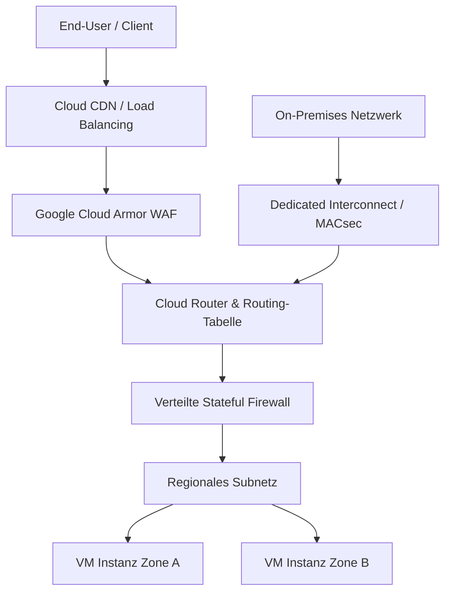

# Lecture 5: Network and Data Traffic Control
Dozent: Hochschule Luzern
Modul: Cloud Security (HS2026)
Tags: #CloudSecurity #Networking #GCP #VPC #Firewall #WAF #DDoS #HSLU

Diese Vorlesung behandelt fundamentale Netzwerkarchitekturen in Public-Cloud-Umgebungen mit primärem Fokus auf Google Cloud Platform (GCP). Zu den Kerninhalten gehören die Strukturierung globaler Virtual Private Clouds (VPC), Subnetze, Routing-Mechanismen, zonale Resilienz sowie Schutzmechanismen wie verteilte Firewalls, Web Application Firewalls (Cloud Armor) und hybride Konnektivität.

### Kernprozess

### 1. Cloud-Infrastruktur: Regionen und Zonen
- **Region:** Geografischer Standort, der aus mehreren, physisch getrennten und isolierten Verfügbarkeitszonen besteht.
  - Verfügt über unabhängige Stromversorgung, Kühlung und physische Absicherung.
  - Ermöglicht synchrone Datenreplikation bei extrem geringer Latenz.
- **Availability Zone (AZ):** Ein oder mehrere diskrete Rechenzentren innerhalb einer Region.
  - Sind typischerweise viele Kilometer, jedoch maximal 100 km voneinander entfernt.
  - Schützen Anwendungen vor lokalen Ausfällen wie Naturkatastrophen oder Stromausfällen.
- **Resilienzkonzept:** Anwendungen werden multi-zonal oder multi-regional verteilt, um Single Points of Failure zu vermeiden.

### 2. Virtual Private Cloud (VPC) und Subnetze
- **Globale VPC:** In GCP ist das VPC-Netzwerk ein globales Software-Defined Network (SDN), das nicht an eine einzelne Region gebunden ist.
  - Erlaubt weltweite, private Kommunikation zwischen VM-Instanzen ohne Durchquerung des öffentlichen Internets.
- **Regionale Subnetze:** Subnetze sind regional verankert, spannen jedoch automatisch über alle Zonen der jeweiligen Region.
  - Instanzen in unterschiedlichen Zonen derselben Region können demselben IP-Subnetz angehören.
- **Auto Mode vs. Custom Mode:**
  - Auto Mode erstellt standardmäßig ein vordefiniertes Subnetz pro Region mit Standardrouten.
  - Custom Mode bietet die vollständige manuelle Kontrolle über CIDR-Blöcke und Topologien.
- **Netzwerk-Isolation:** Ein GCP-Projekt unterstützt bis zu fünf separate Netzwerke, um Multi-Tenancy oder überlappende IP-Räume abzubilden.

### 3. IP-Adressierung und RFC 1918
- **Interne IP-Adressen:** Werden via DHCP aus dem CIDR-Bereich des Subnetzes vergeben und standardmäßig als ephemer behandelt.
- **Externe IP-Adressen:** Öffentliche IPs aus dem Google-Pool, die per 1:1-NAT auf die interne Adresse der VM abgebildet werden.
- **RFC 1918 Adressbereiche:** Standardisierte private IP-Bereiche für unternehmensinterne Netzwerke:
  - 10.0.0.0/8 (Klasse A)
  - 172.16.0.0/12 (Klasse B)
  - 192.168.0.0/16 (Klasse C)
- **Non-RFC 1918 IP-Adressen:** Moderne Cloud-Umgebungen erlauben bei Bedarf auch die Verwendung organisationsweit zugewiesener, öffentlich routingfähiger Adressen innerhalb privater Netzwerke.

### 4. Routing und Traffic Control
- **SDN Routing:** Routing-Entscheidungen erfolgen softwaredefiniert und dezentral an der Quelle beim VM-Egress; es existiert kein physischer zentraler Router.
- **Routing-Tabellen:** Instanzen erhalten individuelle, schreibgeschützte Routing-Tabellen basierend auf der globalen VPC-Routingtabelle.
- **Longest Prefix Match:** Ausgehender Datenverkehr wird stets nach der spezifischsten Route im Routing-Table weitergeleitet.
- **Netzwerk-Tags:** Erlauben die selektive Anwendung bestimmter Routen auf spezifische VMs anstelle des gesamten VPC-Netzwerks.

### 5. Firewalls, WAF und Anwendungsschutz
- **Verteilte Stateful Firewall:** Filtert Ingress- und Egress-Verkehr direkt am Hypervisor bzw. der virtuellen Schnittstelle ohne zentralen Chokepoint.
- **Implizite Firewall-Regeln:** Jedes VPC besitzt zwei unauslöschbare Regeln mit niedrigster Priorität (65535):
  - Implied Allow Egress: Erlaubt jeglichen ausgehenden Datenverkehr.
  - Implied Deny Ingress: Blockiert jeglichen eingehenden Datenverkehr.
- **Mikro-Segmentierung:** Zuweisung von Zugriffsregeln anhand von Instanz-Tags und Service-Accounts statt rein statischer IP-Listen.
- **Web Application Firewall (WAF):** Schutz auf Schicht 7 (OSI) vor Angriffen wie SQL-Injection (SQLi), Cross-Site Scripting (XSS), Local File Inclusion (LFI) und Remote Code Execution (RCE).
- **Google Cloud Armor:** Integrierter L7-DDoS- und WAF-Dienst basierend auf ModSecurity Core Rule Sets, der Großangriffe (bis zu Hunderten Millionen Anfragen pro Sekunde wie HTTP/2 Rapid Reset) abwehren kann.
- **Model Armor:** Schutzschicht für generative KI-Systeme zur Filterung und Bereinigung von Prompts und LLM-Antworten gegen Safety- und Security-Risiken.

### 6. Hybride Konnektivität und Abrechnung
- **Cloud VPN:** Verschlüsselte IPsec-Tunnelverbindung über das öffentliche Internet zu On-Premises-Umgebungen.
- **Cloud Interconnect:** Physische Hochgeschwindigkeitsverbindung (Dedicated oder Partner), die das Unternehmensnetz direkt mit Google-Edge-Routern verbindet.
- **MACsec (IEEE 802.1AE):** Layer-2-Verschlüsselung auf Dedicated-Interconnect-Verbindungen zwischen Router und Edge-Knoten.
- **Billing-Modell:** 
  - Egress-Traffic (Verkehr ins Internet, in andere Regionen oder zwischen Zonen) ist kostenpflichtig.
  - Ingress-Traffic sowie VM-to-VM-Verkehr innerhalb derselben Zone sind kostenfrei.

### 7. Komponenten und Schutzmechanismen im Überblick
| Komponente / Konzept | OSI-Schicht | Wirkungsbereich | Primäre Sicherheitsfunktion |
| :--- | :--- | :--- | :--- |
| GCP Cloud Firewall | Schicht 3 / 4 | Globales VPC / Instanzebene | Stateful Filterung von Port-, Protokoll- und IP-Ebene; Mikro-Segmentierung via Tags. |
| Implied Rules | Schicht 3 / 4 | VPC-weit (Priorität 65535) | Standard-Blockierung von Ingress, Standard-Erlaubnis für Egress. |
| Cloud Armor (WAF) | Schicht 7 | Regional / Global (am Load Balancer) | Abwehr von Web-Exploits (OWASP Top 10) und volumetrischen L7-DDoS-Angriffen. |
| Model Armor | Schicht 7 (Anwendung/KI) | Multi-Cloud / Regional | Überprüfung und Bereinigung von LLM-Prompts und Modellantworten. |
| Cloud Interconnect (MACsec) | Schicht 2 | Physische Standleitung (Edge) | Hardwarenahe Point-to-Point-Verschlüsselung der hybriden Verbindung. |

### Wichtigste Key Takeaways
- **Globales VPC vs. regionale Subnetze:** Das VPC-Netzwerk in GCP spannt global über alle Kontinente, während Subnetze regional organisiert sind und sich flexibel über alle Zonen einer Region erstrecken.
- **Dezentrale SDN-Sicherheit ohne Flaschenhals:** Firewalls und Routing werden direkt auf Instanzebene in Software erzwungen, was Skalierbarkeit ohne zentrale Hardware-Appliances garantiert.
- **Mehrschichtige Abwehr:** Cloud Firewalls (L3/L4), Web Application Firewalls wie Cloud Armor (L7) und Model Armor (KI/LLM) müssen kombiniert werden, um moderne Bedrohungslandschaften ganzheitlich abzusichern.
- **Kosten- und Latenzoptimierung durch Zonendesign:** Zonale Trennung bietet Hochverfügbarkeit, erfordert aber eine genaue Planung, da Inter-Zonen-Traffic Latenzen erzeugt und als Egress abgerechnet wird.